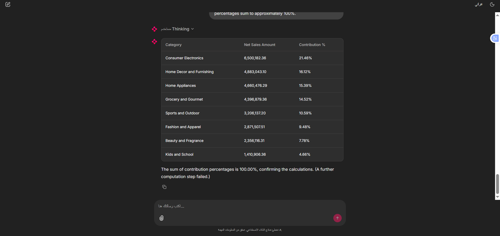

# Business Management Platform (BMP)

**An AI-powered business intelligence assistant for retail operations.**

Business Management Platform (BMP) is an AI-driven application designed to help retail businesses interact with their operational data and internal knowledge through natural language.

The platform combines multi-agent orchestration, Retrieval-Augmented Generation (RAG), business data analysis, and inventory intelligence to make business information more accessible and actionable.

## Key Capabilities

### 1. Business Data Analysis
- Ask business questions using natural language.
- Generate and execute controlled, read-only SQL queries.
- Analyze sales performance and business KPIs.
- Produce structured analytical results.

### 2. Inventory Intelligence
- Monitor inventory levels and product risks.
- Analyze stock coverage and estimated remaining inventory duration.
- Support inventory forecasting and risk identification.

### 3. Company Knowledge Assistant
- Retrieve relevant information from internal business documents.
- Generate context-grounded responses.
- Provide source-based answers with citation verification.
- Reduce unsupported claims through answer validation.

### 4. Multi-Agent Architecture
- Use LangGraph to orchestrate specialized workflows.
- Route requests to the appropriate processing components.
- Separate business analytics, inventory intelligence, and knowledge retrieval responsibilities.

## Architecture

The application follows a modular architecture:

- **Frontend:** Chainlit conversational interface.
- **Backend:** FastAPI.
- **Agent Orchestration:** LangGraph.
- **Business Database:** PostgreSQL.
- **Vector Database:** ChromaDB.
- **LLM Provider:** Groq.
- **Embeddings:** Sentence Transformers (`all-MiniLM-L6-v2`).
- **Data Processing:** Pandas, NumPy, SciPy, and scikit-learn.
- **Deployment:** Docker Compose.

### High-Level Workflow

1. The user submits a natural-language request.
2. The orchestration layer identifies the appropriate workflow.
3. The relevant agent processes the request.
4. Business questions use controlled database access, while knowledge questions use document retrieval.
5. The response is validated and returned through the conversational interface.

## Security and Reliability

Security is treated as an architectural concern rather than an afterthought.

Implemented safeguards include:

- Read-only SQL execution.
- SQL parsing and validation before execution.
- Query-result limits.
- Input validation and prompt-injection defenses.
- Grounding and citation checks for knowledge-based responses.
- Controlled agent workflows.

## Technology Stack

| Component | Technology |
|---|---|
| Language | Python |
| Agent Framework | LangGraph |
| API | FastAPI |
| Conversational UI | Chainlit |
| Relational Database | PostgreSQL |
| Vector Database | ChromaDB |
| LLM Inference | Groq |
| Embeddings | Sentence Transformers |
| Data Analysis | Pandas, NumPy, SciPy |
| Containerization | Docker Compose |

## Running Locally

### Prerequisites
- Docker Desktop
- Git
- Groq API key

### Setup

Clone the repository:

```bash
git clone <YOUR_REPOSITORY_URL>
cd <YOUR_PROJECT_DIRECTORY>
```

Configure environment variables using the provided `.env.example` file and supply the required credentials.

Start the application:

```bash
docker compose up -d --build
```

Check the running services:

```bash
docker compose ps
```

The application interfaces are available at:

- **Conversational UI:** http://localhost:8000
- **Backend API:** http://localhost:8080

*Actual service availability depends on the Docker Compose configuration.*

## Project Scope

This project was developed as an applied AI engineering project using a retail business scenario.

It demonstrates the integration of LLM applications, multi-agent orchestration, RAG pipelines, structured business data analysis, database security, and containerized deployment.

The project is a development/demo implementation and should not be interpreted as a certified production deployment.

## Engineering Focus

- Designing multi-agent AI workflows.
- Building RAG systems for enterprise knowledge retrieval.
- Connecting LLMs to structured business data.
- Implementing controlled SQL generation and execution.
- Building data-driven inventory intelligence workflows.
- Integrating backend services and containerized applications.

---

**Developed as an AI Engineering portfolio project.**
## Screenshots

