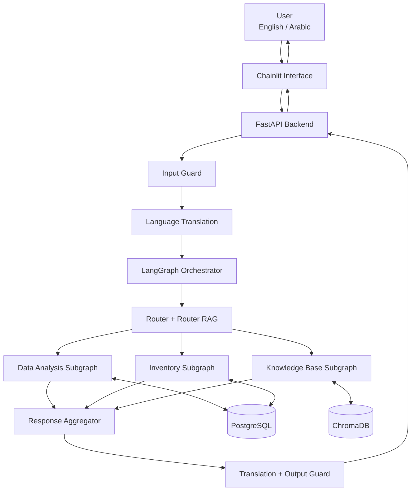
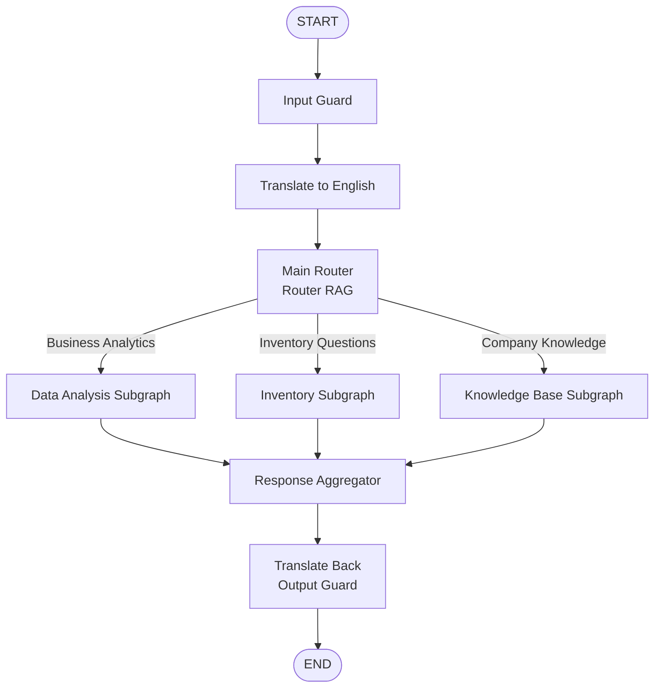
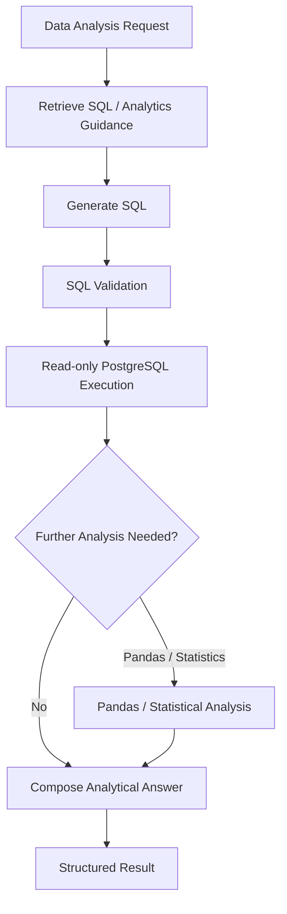
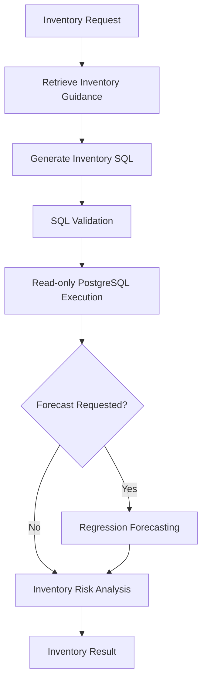
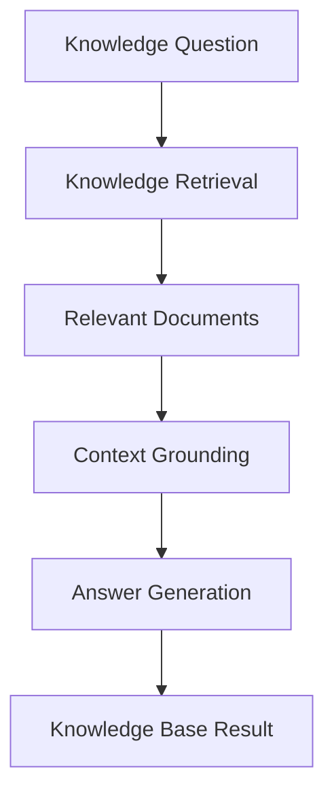
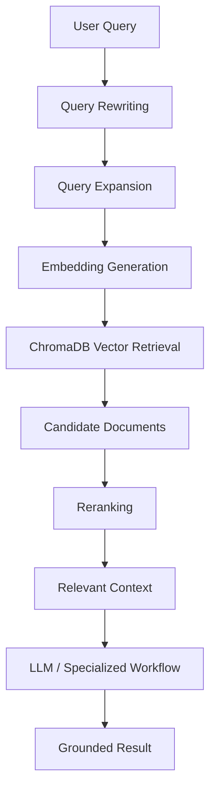

# Business Management Platform (BMP)
## Screenshots


**An AI-powered business intelligence and decision-support platform for retail operations.**

BMP enables business users to ask questions in natural language and receive data-grounded answers about sales performance, inventory risks, forecasts, and internal company knowledge.

Built around a **LangGraph multi-agent architecture**, the platform combines read-only SQL execution, Python-based analytics, statistical testing, regression forecasting, and Retrieval-Augmented Generation (RAG) in one conversational interface.

The system is demonstrated using **Nakhla Retail Group**, a fictional Saudi multi-category retailer.

> **Dataset notice:** Nakhla Retail Group, its employees, customers, suppliers, contracts, branches, and all business figures are fictional and were created for this project.

---

## Table of Contents

- [Project Overview](#project-overview)
- [Core Capabilities](#core-capabilities)
- [System Architecture](#system-architecture)
- [LangGraph Orchestration](#langgraph-orchestration)
- [Specialized Subgraphs](#specialized-subgraphs)
- [RAG Pipeline](#rag-pipeline)
- [Security and Reliability](#security-and-reliability)
- [Technology Stack](#technology-stack)
- [Repository Structure](#repository-structure)
- [Dataset and Knowledge Base](#dataset-and-knowledge-base)
- [Evaluation and Testing](#evaluation-and-testing)
- [Installation and Setup](#installation-and-setup)
- [Running with Docker](#running-with-docker)
- [Documentation](#documentation)
- [Project Status and Limitations](#project-status-and-limitations)

---

## Project Overview

Traditional business intelligence tools often require users to understand database schemas, write SQL queries, or navigate multiple reporting interfaces.

BMP provides a conversational alternative.

A user can ask questions such as:

- "What were the total sales in January 2025?"
- "Which products have the highest inventory risk?"
- "Compare monthly sales between 2024 and 2025."
- "Forecast inventory demand for the next few weeks."
- "What is the company's return and refund policy?"

Instead of treating every question as a generic LLM prompt, BMP identifies the request type and routes it to a specialized workflow.

The platform uses deterministic tools for calculations and database operations, while LLMs handle language understanding, task routing, and response generation.

## Core Capabilities

| Capability | Description |
|---|---|
| Business Analytics | Natural-language business questions translated into read-only SQL and analytical operations. |
| Statistical Analysis | Pandas-based calculations and statistical tests, including hypothesis testing when requested. |
| Inventory Intelligence | Inventory risk assessment, demand analysis, and regression-based forecasting. |
| Enterprise Knowledge Retrieval | Answers questions using internal policies, products, branches, employees, and contract documents. |
| Multilingual Interaction | Accepts English and Arabic questions and returns answers in the language of the original question. |
| Multi-Agent Orchestration | Routes requests to specialized LangGraph subgraphs and combines their results. |

---

## System Architecture

The application is organized into separate layers:

1. **User Interface:** Chainlit provides the conversational experience.
2. **API Layer:** FastAPI handles application requests.
3. **Orchestration Layer:** LangGraph manages routing, state, and specialized workflows.
4. **Execution Layer:** SQL, Pandas, statistical analysis, forecasting, and RAG tools perform the requested operations.
5. **Data Layer:** PostgreSQL stores structured business data, while ChromaDB stores vector representations of knowledge documents.

### High-Level Architecture



The orchestration layer selects the appropriate workflow based on the user's intent. Each specialized subgraph is responsible for its own task and returns a structured result to the aggregator.

---

## LangGraph Orchestration

LangGraph coordinates the application through a shared workflow state.

The main graph performs the following operations:

| Stage | Responsibility |
|---|---|
| Input Guard | Validates and screens incoming user input. |
| Translation | Converts Arabic input into English for downstream processing when required. |
| Router | Identifies the user's intent and selects a specialized subgraph. |
| Data Analysis | Handles business metrics, SQL queries, and statistical analysis. |
| Inventory | Handles stock-related analysis and forecasting. |
| Knowledge Base | Retrieves information from company documents. |
| Aggregator | Combines the results returned by the selected workflow. |
| Output Processing | Applies output checks and translates the final response into the original language. |

### Main LangGraph Workflow



The router determines which workflow is relevant to the request. The selected subgraph executes its task and returns its result for aggregation.

---

## Specialized Subgraphs

### 1. Data Analysis Subgraph

Responsible for answering questions about business performance and historical data.

**Execution responsibilities:**

- Understand the analytical intent.
- Retrieve relevant SQL patterns and schema knowledge through RAG.
- Generate and validate read-only SQL.
- Execute SQL against PostgreSQL.
- Use Pandas for calculations that require further processing.
- Perform statistical tests when requested.
- Produce a structured analytical response.



**Examples of supported analytical tasks:**

- Revenue and sales comparisons.
- Monthly and yearly performance analysis.
- Growth calculations.
- Descriptive statistics.
- Hypothesis testing when requested.
- Business KPI analysis.

### 2. Inventory Subgraph

Responsible for inventory monitoring and demand forecasting.

**Execution responsibilities:**

- Retrieve inventory-specific SQL and forecasting guidance.
- Query inventory and sales history.
- Identify stock risks and relevant product metrics.
- Prepare historical demand data.
- Run regression-based forecasting when requested.
- Evaluate forecast results and produce inventory recommendations.



### 3. Knowledge Base Subgraph

Responsible for answering questions about internal company information.

The knowledge base contains fictional company documentation covering:

- Company policies.
- Branch information.
- Products and categories.
- Employee information.
- Supplier contracts.
- Customer contracts.

The subgraph retrieves relevant documents through the RAG pipeline and generates an answer grounded in the retrieved context.



---

## RAG Pipeline

BMP uses Retrieval-Augmented Generation to provide relevant context to the router and specialized workflows.

The RAG system uses separate knowledge collections for routing, data analysis, inventory, and company knowledge.

### Retrieval Workflow



### Main RAG Components

| Component | Responsibility |
|---|---|
| Query Rewriting | Improves the original query for retrieval. |
| Query Expansion | Generates alternative query formulations to improve recall. |
| Embeddings | Converts text into vector representations using `all-MiniLM-L6-v2`. |
| ChromaDB | Stores and retrieves vectorized document chunks. |
| Reranking | Reorders retrieved candidates by relevance. |
| Context Assembly | Prepares retrieved information for the downstream workflow. |

The retrieval pipeline is designed to separate document retrieval from business-data execution. Structured analytics use PostgreSQL and analytical tools; company knowledge questions use document retrieval.

---

## Security and Reliability

Security is integrated into the workflow rather than treated as a separate feature.

### SQL Security

- SQL validation before execution.
- Read-only database credentials.
- Read-only transaction enforcement.
- Restricted query operations.

### Input and Output Protection

- Input screening and validation.
- Prompt-injection protection.
- Output validation and screening.
- Restricted access to sensitive information.

### Pandas Execution Controls

- Validation of generated analytical code.
- Restricted execution through a separate worker.
- Controlled analytical execution.

### LLM Reliability

- Centralized LLM client.
- Request and size limits.
- Error handling and fallback behavior.
- Structured responses between workflow components.

For implementation details, see [`docs/05_security_and_guardrails.md`](docs/05_security_and_guardrails.md) and [`RAG_REFACTOR_REPORT.md`](RAG_REFACTOR_REPORT.md).

---

## Technology Stack

| Layer | Technology | Purpose |
|---|---|---|
| Agent Orchestration | LangGraph | Stateful workflows and multi-agent coordination. |
| Backend | FastAPI | Application API. |
| Frontend | Chainlit | Conversational user interface. |
| Relational Database | PostgreSQL 16 | Structured retail business data. |
| Vector Database | ChromaDB | RAG document storage and retrieval. |
| LLM | `openai/gpt-oss-120b` via Groq | Language understanding and generation. |
| Embeddings | `all-MiniLM-L6-v2` | Semantic document embeddings. |
| Analytics | Pandas | Data processing and calculations. |
| Forecasting | Regression models | Inventory demand forecasting. |
| Containers | Docker Compose | Local multi-service deployment. |
| Package Management | uv | Python dependency management. |

---

## Repository Structure

```text
business-management-platform/
│
├── app/
│   ├── graph/             # Main graph and specialized subgraphs
│   ├── guards/            # Input, SQL, Pandas, and output validation
│   ├── llm/               # LLM client and integration
│   ├── rag/               # Retrieval, embeddings, chunking, reranking
│   ├── tools/              # SQL, Pandas, RAG, and regression tools
│   ├── api_core.py         # Core application logic
│   └── main.py             # FastAPI application
│
├── ui/
│   └── chainlit_app.py     # Chainlit conversational interface
│
├── database/
│   ├── generator/          # Synthetic dataset generation
│   └── sql/                # Database schema and data SQL files
│
├── rag_sources/
│   ├── router/             # Routing knowledge
│   ├── data_analysis/      # SQL and analytics guidance
│   ├── inventory/          # Inventory and forecasting guidance
│   └── knowledge_base/     # Company policies and reference documents
│
├── docs/                   # Requirements, architecture, design, security
├── evaluation/             # Evaluation scenarios and coverage
├── tests/                  # Unit, integration, and security tests
│
├── Dockerfile
├── docker-compose.yml
├── pyproject.toml
├── uv.lock
└── README.md
```

---

## Dataset and Knowledge Base

The platform uses a synthetic retail dataset designed to demonstrate realistic business workflows.

| Dataset Area | Description |
|---|---|
| Retail Network | Nine fictional locations. |
| Product Catalog | 120 SKUs across eight product lines. |
| Sales History | Historical orders and order items. |
| Inventory | Inventory snapshots and stock-related records. |
| Company Knowledge | Policies, branches, employees, products, and contracts. |

The Phase 2 dataset contains approximately 121,257 orders and 306,000 order lines.

The data is synthetic and does not represent an actual company's operational records.

---

## Evaluation and Testing

The project includes a scenario-based evaluation suite covering different workflow types.

The evaluation scenarios cover:

- Intent routing.
- Business data analysis.
- Inventory monitoring and forecasting.
- Knowledge retrieval.
- Cross-subgraph behavior.
- Arabic and English interactions.
- Security and robustness.

The repository also contains unit and security tests for SQL validation, Pandas validation, RAG retrieval, regression tools, and workflow behavior.

See [`evaluation/00_index.md`](evaluation/00_index.md) for the evaluation structure.
## Evaluation

The system was tested against 200 evaluation scenarios spanning all three LangGraph subgraphs (data analysis, inventory forecasting, and company-knowledge retrieval).

- **Scenarios tested:** 200
- **Task-completion rate:** 95%


---

## Installation and Setup

### Prerequisites

- Windows 10/11 or another Docker-compatible operating system.
- Docker Desktop with WSL 2 enabled on Windows.
- A Groq API key.
- Approximately 2 GB of free disk space for the initial container images, plus storage for database and vector volumes.

### 1. Clone the Repository

```bash
git clone https://github.com/ma1868801-afk/business-management-platform.git
cd business-management-platform
```

### 2. Configure Environment Variables

Create a `.env` file in the project root.

At minimum, configure:

```env
GROQ_API_KEY=your_groq_api_key
BMP_READONLY_PASSWORD=your_readonly_database_password
```

Use your own credentials. Never commit the real `.env` file.

### 3. Start the Application

```bash
docker compose up --build -d
```

### 4. Open the Interface

Once the containers are ready, open:

```text
http://localhost:8000
```

The Chainlit interface provides the conversational entry point to the platform.

---

## Running with Docker

The Docker Compose stack includes the following services:

| Service | Responsibility |
|---|---|
| `db` | PostgreSQL database and business dataset. |
| `db-init` | Creates the restricted read-only database role. |
| `chroma` | ChromaDB vector database server. |
| `indexer` | Indexes the RAG source documents. |
| `app` | FastAPI backend and LangGraph workflows. |
| `ui` | Chainlit user interface. |

### Useful Commands

Check service status:

```bash
docker compose ps
```

View application logs:

```bash
docker compose logs -f app
```

View interface logs:

```bash
docker compose logs -f ui
```

Stop the services while preserving persistent data:

```bash
docker compose down
```

Stop the services and remove database and vector volumes:

```bash
docker compose down -v
```

> **Warning:** `docker compose down -v` deletes the persistent database and vector-index volumes. The next startup will need to initialize the data and rebuild the index.

---

## Documentation

The `docs/` directory contains the detailed engineering specifications.

| Document | Description |
|---|---|
| [`01_requirements.md`](docs/01_requirements.md) | Requirements, assumptions, and traceability. |
| [`02_architecture.md`](docs/02_architecture.md) | System architecture, graph design, routing, and workflow contracts. |
| [`03_database_design.md`](docs/03_database_design.md) | Database schema, views, roles, and data guarantees. |
| [`04_rag_design.md`](docs/04_rag_design.md) | Chunking, embeddings, retrieval, and reranking. |
| [`05_security_and_guardrails.md`](docs/05_security_and_guardrails.md) | Security model and validation mechanisms. |
| [`06_evaluation_plan.md`](docs/06_evaluation_plan.md) | Evaluation methodology and metrics. |
| [`07_reference_entities.md`](docs/07_reference_entities.md) | Central registry of fictional business entities. |
| [`08_phase_plan.md`](docs/08_phase_plan.md) | Project phases and delivery plan. |
| [`11_deployment_guide.md`](docs/11_deployment_guide.md) | Deployment guidance. |
| [`12_chromadb_migration.md`](docs/12_chromadb_migration.md) | ChromaDB migration details. |

Additional implementation and completion reports are available in the repository.

---

## Project Status and Limitations

The project is organized into three delivered phases:

| Phase | Deliverable |
|---|---|
| Phase 1 | Requirements, architecture documentation, RAG sources, and evaluation scenarios. |
| Phase 2 | PostgreSQL schema, synthetic dataset, and verification scripts. |
| Phase 3 | FastAPI backend, LangGraph workflows, RAG implementation, Chainlit interface, and Docker deployment. |

**Current scope and limitations:**

- The system is a portfolio and engineering demonstration built around fictional business data.
- The application requires a valid Groq API key for LLM functionality.
- Initial startup requires building containers and loading the database and vector index.
- Actual model behavior and end-to-end reliability depend on the configured runtime environment and external model service.
- The project is not presented as a production deployment for a real retailer.

---

## Author

**AI Engineering Project**

Developed to demonstrate practical AI engineering skills in:

- Multi-agent orchestration with LangGraph.
- Retrieval-Augmented Generation.
- Natural-language business analytics.
- Secure SQL and analytical execution.
- Inventory forecasting.
- Backend development and containerized deployment.

**Repository:** [Business Management Platform](https://github.com/ma1868801-afk/business-management-platform)