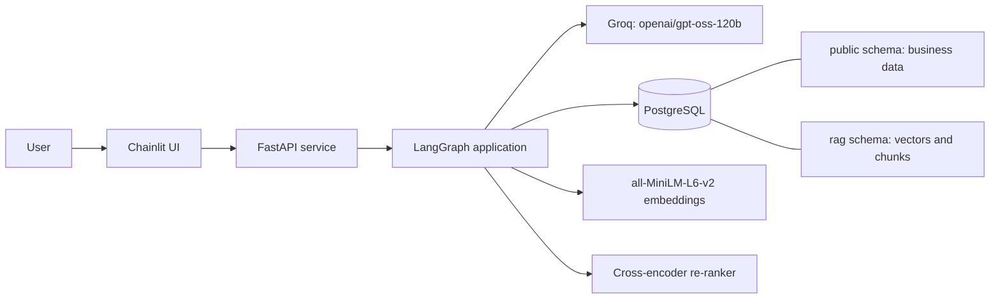
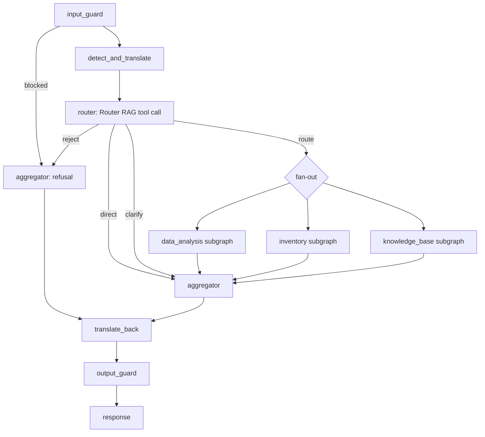
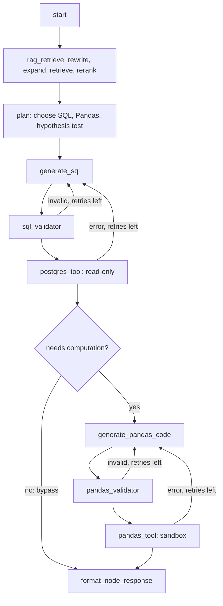
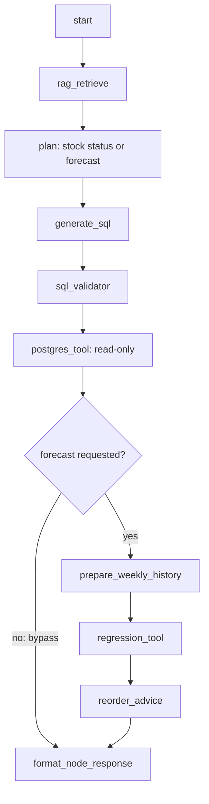
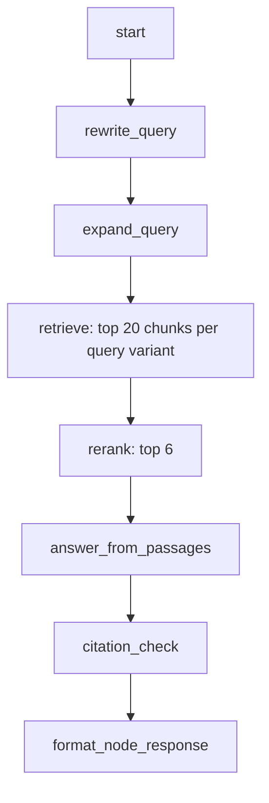

# 02. System Architecture and Data Flow

This document describes the target architecture for Phase 3. It is a design only; no application code exists yet. It follows the approved data flow: primary LLM, Router RAG, subgraph, final aggregator.

## 1. System Context



Containers (Docker Compose): `app` (FastAPI and LangGraph), `ui` (Chainlit), `db` (PostgreSQL with pgvector). An `indexer` job builds the RAG indexes from `rag_sources/`. Packages are managed with uv. All configuration comes from environment variables.

## 2. Top-Level Graph



### Node Responsibilities

| Node | Model | Purpose |
|---|---|---|
| input_guard | rules and small LLM check | Length, character and pattern checks; prompt injection screening (see security document). |
| detect_and_translate | primary LLM | Detects Arabic or English, resolves follow-up references from the conversation, produces a standalone English question. |
| router | primary LLM with Router RAG tool | Calls the Router RAG and returns the routing decision (section 3). |
| subgraphs | subgraph LLM | Produce node responses (section 5). Run in parallel when several are selected. |
| aggregator | aggregator LLM | Merges node responses into one English answer, or answers directly for greetings, clarifications and refusals. |
| translate_back | aggregator LLM | Translates to Arabic if the user wrote Arabic; keeps digits, entity names and codes unchanged. |
| output_guard | rules | Redacts PII patterns, removes system text, checks that numbers in the answer appear in node responses. |

### Graph State

```python
class GraphState(TypedDict):
    session_id: str
    user_text: str                 # original message
    user_language: str             # "en" or "ar"
    question_en: str               # standalone English question
    guard: dict                    # input guard verdict and reasons
    route: dict                    # routing decision (section 3)
    node_responses: list[dict]     # one per executed subgraph (section 5)
    answer_en: str                 # merged English answer
    answer_final: str              # answer in the user's language
    trace: list[dict]              # per-node timing, tool calls, retries
```

## 3. Router RAG and Routing Decision

The router calls the `router_rag` tool, which retrieves from the `router` index (subgraph descriptions, routing rules, routing examples). The routing decision is JSON:

```json
{
  "decision": "route",
  "subgraphs": [
    {"name": "data_analysis", "sub_question": "...", "hints": {"needs_computation": true, "hypothesis_test": false}},
    {"name": "inventory", "sub_question": "...", "hints": {"forecast_requested": true, "horizon_weeks": 8}}
  ],
  "clarification_question": null,
  "reject_reason": null,
  "reason": "..."
}
```

Allowed values: `decision` is route, clarify, direct or reject; `reject_reason` is write_request, restricted_data, prompt_injection or off_topic; subgraph `name` is data_analysis, inventory or knowledge_base. The JSON is validated against a schema; invalid output is retried once, then the request falls back to a clarification.

## 4. Subgraphs

### 4.1 Data Analysis



- The hypothesis test is generated as Pandas code only when `hypothesis_test` is true or the plan finds an explicit request for significance.
- Retry budget: at most two retries per tool stage; then the node returns `status = "failed"` with a plain explanation.

### 4.2 Inventory



- The bypass condition is strict: the Regression Model never runs for current quantities, status lists, supplier facts or historical sales.
- `prepare_weekly_history` fills missing weeks with zero, applies the stockout adjustment and checks the minimum history rules from the regression input guidelines.

### 4.3 Knowledge Base



- The answer must be grounded in the retrieved passages. If the passages do not contain the answer, the node says so; it never answers from general knowledge.
- The citation check verifies that each stated fact appears in a cited passage.

## 5. Common Node Response

Every subgraph returns the same structure so the aggregator can merge them:

```json
{
  "subgraph": "data_analysis",
  "status": "ok",
  "answer_en": "Short English answer with the key numbers.",
  "key_figures": [{"label": "Net revenue 2025", "value": 123456.78, "unit": "SAR"}],
  "assumptions": ["Revenue is net of discounts and excludes VAT.", "Period: 2025-01-01 to 2025-12-31."],
  "method": {"tools_used": ["postgres", "pandas"], "bypassed": [], "queries": 2},
  "sources": [{"type": "table", "name": "v_sales_detail"}],
  "warnings": [],
  "error": null
}
```

`status` is ok, partial or failed. `sources` lists tables or documents (file titles for the knowledge base). Executed SQL and code are kept in the trace, not shown to the user unless asked.

## 6. Tool Contracts

### 6.1 postgres_tool

- **Input:** `{"sql": "<single SELECT or WITH statement>", "max_rows": 500}`.
- **Output:** `{"columns": [...], "rows": [[...]], "row_count": n, "truncated": false, "elapsed_ms": 42}` or `{"error": {"code": "...", "message": "..."}}`.
- **Rules:** the validator allows SELECT and WITH only, a single statement, tables and views from the allow-list, no SELECT *, no blocked columns, and a LIMIT on raw extractions. The connection uses the role `bmp_readonly`, `default_transaction_read_only = on`, `statement_timeout = 8s`, and `idle_in_transaction_session_timeout = 10s`.

### 6.2 pandas_tool

- **Input:** `{"code": "...", "dataframes": {"df": <result of SQL 1>, "dfs": {"name": <result>}}}`.
- **Output:** `{"result": <table, series, dict or scalar>, "facts": {...}, "elapsed_ms": 120}` or an error object.
- **Sandbox:** names `df`, `dfs`, `pd`, `np`, `stats`, `math`; no imports, no file or network access; 50,000 input rows; 5 second limit; 200 output rows. Static AST check before execution, run in a separate process with CPU and memory limits.

### 6.3 regression_tool

- **Input:** `{"history": [{"week_start_date": "2025-01-05", "units_sold": 41, "promo_units": 0, "stockout_days": 0}], "series_level": "sku_total", "entity": {"sku": "ELEC-0001"}, "horizon_weeks": 8, "interval": 0.8, "assumptions": {"promo": "none", "price": "current"}, "with_reorder_advice": true}`.
- **Output:** forecast rows (`week_start_date`, `forecast`, `lower`, `upper`), model name, holdout metrics (WAPE, bias), confidence label, notes (adjustments, cold start) and optional reorder advice.
- **Rules:** see the Inventory RAG files `04_regression_input_guidelines.md` and `05_forecasting_models_and_evaluation.md`.

### 6.4 rag_tool (one per index)

- **Input:** `{"index": "router|data_analysis|inventory|knowledge_base", "query": "..."}`.
- **Pipeline:** query rewriting, query expansion, vector retrieval, re-ranking. See `04_rag_design.md`.
- **Output:** ranked passages with `doc_id`, title, section path, text and score.

## 7. Aggregator Rules

1. Use only facts and numbers present in node responses.
2. Keep the order of the user's question; one short paragraph per answered part.
3. State assumptions and warnings that change how a number should be read.
4. If one subgraph failed and another succeeded, answer the successful part and say what could not be answered.
5. For a refusal, give a short reason and offer what can be done instead.
6. Translate to Arabic only at the end. Keep SKU codes, branch codes, product and person names, and numbers unchanged.
7. If the user explicitly asks for an answer language (for example "answer in English"), use that language instead of the language of the question.

## 8. Error Handling and Limits

| Situation | Behavior |
|---|---|
| Groq rate limit or timeout | Retry up to 2 times with backoff; then return a friendly error. |
| SQL validation failure | Regenerate with the validator message, at most 2 times. |
| Empty SQL result | Report "no matching data" with the filters used; do not invent values. |
| Pandas error | Regenerate with the error message, at most 2 times. |
| Forecast with too little history | Cold-start estimate with low confidence label, or refusal if no sales exist. |
| Request over the end of data | Explain that data ends on 2026-10-31. |
| Total request time budget | 60 seconds; partial answers are returned when one subgraph exceeds its budget. |

## 9. Observability

- Each request has a trace id. The trace stores node timings, retrieved document ids, validated SQL, tool errors and retry counts.
- Logs never contain customer names, emails or phone numbers. Tool outputs are truncated in logs.
- The evaluation harness reads traces to check the route, the tools used and the bypass decisions.

## 10. Proposed Repository Layout (Phase 3)

```text
business-management-platform/
  pyproject.toml            # uv project
  docker-compose.yml
  app/
    main.py                 # FastAPI app
    graph/                  # LangGraph definitions: top-level and three subgraphs
    tools/                  # postgres, pandas, regression, rag tools
    rag/                    # ingestion, chunking, retrieval, re-ranking
    guards/                 # input and output guardrails, SQL and code validators
    config.py
  ui/chainlit_app.py
  db/                       # Phase 2 output: schema and dataset .sql
  rag_sources/              # Phase 1 output: indexed documents
  evaluation/               # Phase 1 output and test harness
  tests/
```

## 11. Configuration (Environment Variables)

| Variable | Purpose |
|---|---|
| `GROQ_API_KEY` | Groq credentials. |
| `LLM_MODEL` | Default `openai/gpt-oss-120b`. |
| `DATABASE_URL_READONLY` | Connection string for role `bmp_readonly`. |
| `DATABASE_URL_RAG` | Connection string for the role that reads and writes the `rag` schema. |
| `EMBEDDING_MODEL` | Default `sentence-transformers/all-MiniLM-L6-v2`. |
| `RERANKER_MODEL` | Default `cross-encoder/ms-marco-MiniLM-L-6-v2`. |
| `REFERENCE_DATE` | Default `2026-10-31`. |
| `MAX_REQUEST_SECONDS` | Default 60. |
