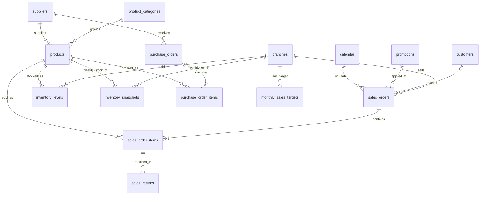

# 03. Database Design (Contract for Phase 2)

This document defines the PostgreSQL schema, the views, the database roles, the data volumes and the data guarantees that the Phase 2 dataset must satisfy. Phase 2 has not started. The data dictionary below is generated from the same specification that produced the RAG schema references, so the documents cannot disagree.

## 1. Design Principles

- **Three domains:** Sales, Customers and Inventory, plus shared reference tables (requirement R-06).
- **Continuous history:** 2024-01-01 to 2026-10-31 (requirement R-07). The reference date for analysis is 2026-10-31.
- **Rich attributes:** every transaction carries branch, channel, timestamp, hour, season, payment method, promotion and customer context (requirement R-08).
- **Currency and tax:** SAR. Prices and revenue exclude 15 percent VAT.
- **Weeks:** retail weeks run Sunday to Saturday. `calendar.day_of_week` uses 0 for Sunday to 6 for Saturday. The weekend is Friday and Saturday.
- **Time:** timestamps are local Riyadh time (UTC+3) stored without time zone.
- **Read-only access:** the assistant connects with the role `bmp_readonly` (section 7).
- **Schemas:** business data in `public`; vectors and chunks for RAG in `rag` (not visible to the read-only role).
- **Language:** all stored text values are English.

## 2. Entity Relationship Diagram



## 3. Tables and Volumes

| Table | Group | Approximate rows | Purpose |
|---|---|---|---|
| `branches` | Reference | 9 | One row per business location: eight retail stores plus the Riyadh Distribution Center (which also fulfils online and B2B orders). |
| `product_categories` | Reference | 8 | The eight product lines of the company. Product line and category mean the same thing. |
| `suppliers` | Reference | 16 | Sixteen contracted suppliers, two per product line. Values match the supplier contracts in the knowledge base. |
| `products` | Reference | 120 | Product master with 120 SKUs, fifteen per product line. Prices exclude VAT. |
| `customers` | Customers | about 6,000 | About 6,000 registered customers: individual consumers and business accounts. Twelve business accounts have contracts documented in the knowledge base... |
| `promotions` | Sales | about 40 | Promotion master used to explain discounts and promotional uplift. About 40 promotions between 2024 and October 2026. |
| `calendar` | Reference | 1,035 | One row for every day from 2024-01-01 to 2026-10-31 (1,035 rows) with Saudi retail seasons and event flags. |
| `monthly_sales_targets` | Sales | 306 | Monthly revenue target for each location (9 locations x 34 months = 306 rows). |
| `sales_orders` | Sales | about 120,000 | Order header, one row per customer order or in-store transaction (about 120,000 rows, 2024-01-01 to 2026-10-31). |
| `sales_order_items` | Sales | about 300,000 | Order lines, one row per product on an order (about 300,000 rows). |
| `sales_returns` | Sales | about 9,000 | Product returns and refunds (about 9,000 rows). Returns happen within 14 days of the order, or 30 days for Defective items. |
| `inventory_levels` | Inventory | about 840 | Current stock position per location and product as of the reference date 2026-10-31 (about 840 rows: all 120 SKUs at the Distribution Center, about 90... |
| `inventory_snapshots` | Inventory | about 120,000 | Weekly end-of-week (Saturday) stock history per location and product, from 2024-01-06 to 2026-10-31 (148 weekly snapshots, about 120,000 rows). |
| `purchase_orders` | Inventory | about 5,000 | Purchase order headers placed with suppliers (about 5,000 rows). |
| `purchase_order_items` | Inventory | about 16,000 | Purchase order lines (about 16,000 rows). |
| `stock_adjustments` | Inventory | about 3,000 | Non-sales stock movements such as damage, expiry, shrinkage and count corrections (about 3,000 rows). |

## 4. Data Dictionary

### `branches`

One row per business location: eight retail stores plus the Riyadh Distribution Center (which also fulfils online and B2B orders).

- **Group:** Reference  
- **Approximate rows:** 9  
- **Primary key:** `branch_id`  

| Column | Type | Null | Description |
|---|---|---|---|
| `branch_id` | INTEGER | no | Primary key. |
| `branch_code` | VARCHAR(10) | no | Unique short code such as RYD-OLY, JED-THL, DMM-FSL, RYD-DC. |
| `branch_name` | VARCHAR(80) | no | Display name, for example 'Riyadh Olaya Flagship'. |
| `city` | VARCHAR(40) | no | City: Riyadh, Jeddah, Dammam, Al Khobar, Madinah or Abha. |
| `region` | VARCHAR(20) | no | Macro region: Central, Western, Eastern or Southern. |
| `branch_type` | VARCHAR(30) | no | Flagship Store, Standard Store, Express Store or Distribution Center. |
| `opening_date` | DATE | no | Date the location opened (all earlier than 2024-01-01). |
| `area_sqm` | INTEGER | no | Floor area in square meters. |
| `staff_count` | INTEGER | no | Number of employees at the location. |
| `manager_name` | VARCHAR(80) | no | Current branch manager; matches the employee records in the knowledge base. |
| `fulfills_online` | BOOLEAN | no | True only for the Distribution Center. |
| `opening_hours` | VARCHAR(20) | yes | Daily opening hours. |
| `is_active` | BOOLEAN | no | True for all nine locations. |

### `product_categories`

The eight product lines of the company. Product line and category mean the same thing.

- **Group:** Reference  
- **Approximate rows:** 8  
- **Primary key:** `category_id`  

| Column | Type | Null | Description |
|---|---|---|---|
| `category_id` | INTEGER | no | Primary key. |
| `category_code` | VARCHAR(10) | no | ELEC, APPL, FASH, GROC, BEAU, SPRT, KIDS or HOME. |
| `category_name` | VARCHAR(60) | no | Consumer Electronics, Home Appliances, Fashion and Apparel, Grocery and Gourmet, Beauty and Fragrance, Sports and Outdoor, Kids and School, Home Decor and Furnishing. |
| `department` | VARCHAR(40) | no | Technology, Lifestyle, Consumables or Family and Leisure. |
| `target_margin_pct` | NUMERIC(5,2) | no | Target gross margin percentage for the line. |
| `peak_season` | VARCHAR(60) | yes | Main commercial season(s) in which the line peaks. |
| `description` | TEXT | yes | Short description of the line. |

### `suppliers`

Sixteen contracted suppliers, two per product line. Values match the supplier contracts in the knowledge base.

- **Group:** Reference  
- **Approximate rows:** 16  
- **Primary key:** `supplier_id`  
- **Foreign keys:** `primary_category_id -> product_categories.category_id`  

| Column | Type | Null | Description |
|---|---|---|---|
| `supplier_id` | INTEGER | no | Primary key. |
| `supplier_code` | VARCHAR(10) | no | SUP-01 to SUP-16. |
| `supplier_name` | VARCHAR(100) | no | Legal name of the supplier. |
| `country` | VARCHAR(40) | no | Country of the supplier. |
| `city` | VARCHAR(40) | yes | City of the supplier. |
| `primary_category_id` | INTEGER | no | Main product line supplied. |
| `lead_time_days` | INTEGER | no | Contractual standard lead time from order to delivery at the Distribution Center, from 4 to 45 days. |
| `min_order_qty` | INTEGER | no | Minimum order quantity in units per purchase order line. |
| `payment_terms_days` | INTEGER | no | Payment terms in days from invoice date. |
| `on_time_delivery_pct` | NUMERIC(5,2) | no | Contractual or measured on-time delivery percentage. |
| `quality_rating` | NUMERIC(2,1) | no | Quality rating from 1.0 to 5.0. |
| `billing_currency` | VARCHAR(3) | no | Currency used on supplier invoices: SAR, USD, EUR or AED. |
| `contract_number` | VARCHAR(20) | no | Contract number, for example SC-2023-001. |
| `contract_start_date` | DATE | no | Date of the contract. |
| `contract_end_date` | DATE | no | End of the current contract term (after automatic renewals) as of 2026-10-31. |
| `is_active` | BOOLEAN | no | True for all suppliers. |

### `products`

Product master with 120 SKUs, fifteen per product line. Prices exclude VAT.

- **Group:** Reference  
- **Approximate rows:** 120  
- **Primary key:** `product_id`  
- **Foreign keys:** `category_id -> product_categories.category_id`; `supplier_id -> suppliers.supplier_id`  

| Column | Type | Null | Description |
|---|---|---|---|
| `product_id` | INTEGER | no | Primary key. |
| `sku` | VARCHAR(12) | no | Unique stock keeping unit such as ELEC-0001. |
| `product_name` | VARCHAR(120) | no | Product display name. |
| `category_id` | INTEGER | no | Product line. |
| `subcategory` | VARCHAR(60) | no | Sub-range inside the product line, for example 'Camping Gear'. |
| `brand` | VARCHAR(60) | no | Brand name. |
| `supplier_id` | INTEGER | no | Contracted supplier. |
| `unit_cost` | NUMERIC(10,2) | no | Current standard landed cost per unit in SAR. |
| `unit_price` | NUMERIC(10,2) | no | Current list selling price per unit in SAR, excluding VAT. Always above unit_cost. |
| `unit_of_measure` | VARCHAR(10) | no | Each, Pack, Box, Kg or Set. |
| `shelf_life_days` | INTEGER | yes | Shelf life in days for perishable or dated items; NULL for non-perishable items. |
| `is_seasonal` | BOOLEAN | no | True when demand is concentrated in a specific season. |
| `peak_season` | VARCHAR(40) | yes | Commercial season in which demand peaks. |
| `lifecycle_status` | VARCHAR(15) | no | New, Active, Declining or Discontinued. |
| `launch_date` | DATE | no | Date the SKU was first sold; at least three SKUs launched in 2026. |
| `discontinued_date` | DATE | yes | Date the SKU was discontinued, NULL otherwise. |
| `weight_kg` | NUMERIC(8,2) | yes | Unit weight in kilograms. |
| `origin_country` | VARCHAR(40) | yes | Country of origin. |

### `customers`

About 6,000 registered customers: individual consumers and business accounts. Twelve business accounts have contracts documented in the knowledge base.

- **Group:** Customers  
- **Approximate rows:** about 6,000  
- **Primary key:** `customer_id`  
- **Foreign keys:** `preferred_branch_id -> branches.branch_id`  
- **Note:** The read-only database role has column-level SELECT on every column of this table except email and phone, so SELECT * on customers fails and column lists must be explicit.  

| Column | Type | Null | Description |
|---|---|---|---|
| `customer_id` | INTEGER | no | Primary key. |
| `customer_code` | VARCHAR(12) | no | Unique code: CUST-000001 style for individuals and CUST-B001 style for contract business accounts. |
| `customer_type` | VARCHAR(12) | no | Individual or Business. |
| `full_name` | VARCHAR(120) | no | Customer name or company name (synthetic). |
| `gender` | VARCHAR(10) | yes | Male or Female for individuals; NULL for businesses. |
| `age_group` | VARCHAR(10) | yes | 18-24, 25-34, 35-44, 45-54 or 55+; NULL for businesses. |
| `city` | VARCHAR(40) | no | Home city of the customer. |
| `region` | VARCHAR(20) | no | Macro region of the customer city. |
| `customer_segment` | VARCHAR(12) | no | Marketing value segment assigned at registration review: Premium, Core or Occasional. |
| `loyalty_tier` | VARCHAR(10) | no | None, Silver, Gold or Platinum (Nakhla Rewards programme). |
| `loyalty_points` | INTEGER | no | Current loyalty points balance. |
| `registration_date` | DATE | no | Date the customer registered; ranges from before 2024 to October 2026. |
| `acquisition_channel` | VARCHAR(20) | no | Walk-in, Website, Mobile App, Social Media, Referral or B2B Sales. |
| `preferred_branch_id` | INTEGER | yes | Most frequently used branch at registration. |
| `marketing_opt_in` | BOOLEAN | no | True when the customer agreed to receive marketing messages. |
| `contract_number` | VARCHAR(20) | yes | Contract number for the twelve contract business accounts; NULL otherwise. |
| `credit_limit` | NUMERIC(12,2) | yes | Approved credit limit in SAR for business accounts; NULL for individuals. |
| `payment_terms_days` | INTEGER | yes | Payment terms for business accounts; NULL for individuals. |
| `email` | VARCHAR(120) | yes | PII. Not readable by the read-only role. |
| `phone` | VARCHAR(20) | yes | PII. Not readable by the read-only role. |
| `is_active` | BOOLEAN | no | False for accounts closed on customer request. |

### `promotions`

Promotion master used to explain discounts and promotional uplift. About 40 promotions between 2024 and October 2026.

- **Group:** Sales  
- **Approximate rows:** about 40  
- **Primary key:** `promotion_id`  
- **Foreign keys:** `category_id -> product_categories.category_id`  

| Column | Type | Null | Description |
|---|---|---|---|
| `promotion_id` | INTEGER | no | Primary key. |
| `promotion_code` | VARCHAR(20) | no | Unique code such as PROMO-WF-2025. |
| `promotion_name` | VARCHAR(100) | no | Display name such as 'White Friday 2025'. |
| `promotion_type` | VARCHAR(20) | no | Percentage Off, Bundle Deal, Seasonal Sale, Loyalty Bonus or Clearance. |
| `discount_pct` | NUMERIC(5,2) | no | Headline discount percentage. |
| `start_date` | DATE | no | First day of the promotion. |
| `end_date` | DATE | no | Last day of the promotion. |
| `season` | VARCHAR(30) | yes | Commercial season the promotion belongs to. |
| `category_id` | INTEGER | yes | Product line the promotion applies to; NULL means store-wide. |
| `channel_scope` | VARCHAR(10) | no | All, In-Store or Online. |
| `min_basket_amount` | NUMERIC(10,2) | yes | Minimum basket value to qualify, if any. |

### `calendar`

One row for every day from 2024-01-01 to 2026-10-31 (1,035 rows) with Saudi retail seasons and event flags.

- **Group:** Reference  
- **Approximate rows:** 1,035  
- **Primary key:** `date_key`  

| Column | Type | Null | Description |
|---|---|---|---|
| `date_key` | DATE | no | Primary key; the calendar date. |
| `year` | SMALLINT | no | Calendar year. |
| `quarter` | SMALLINT | no | Quarter 1 to 4. |
| `month` | SMALLINT | no | Month 1 to 12. |
| `month_name` | VARCHAR(10) | no | January to December. |
| `week_start_date` | DATE | no | Sunday that starts the retail week containing the date. |
| `week_of_year` | SMALLINT | no | Retail week number (weeks start on Sunday). |
| `day_of_month` | SMALLINT | no | Day number 1 to 31. |
| `day_of_week` | SMALLINT | no | 0 = Sunday, 1 = Monday, ..., 5 = Friday, 6 = Saturday (PostgreSQL DOW convention). |
| `day_name` | VARCHAR(10) | no | Sunday to Saturday. |
| `is_weekend` | BOOLEAN | no | True for Friday and Saturday (the Saudi weekend). |
| `is_holiday` | BOOLEAN | no | True on official public holidays. |
| `holiday_name` | VARCHAR(40) | yes | Founding Day, Eid al-Fitr Holiday, Arafat Day, Eid al-Adha Holiday or National Day. |
| `season` | VARCHAR(30) | no | Single commercial season: Ramadan, Eid al-Fitr, Hajj and Eid al-Adha, White Friday, National Day, Founding Day, Back to School, Summer, Winter or Regular. |
| `climate_season` | VARCHAR(10) | no | Winter (Dec-Feb), Spring (Mar-May), Summer (Jun-Sep) or Autumn (Oct-Nov). |
| `is_ramadan` | BOOLEAN | no | True during Ramadan. |
| `is_eid` | BOOLEAN | no | True during the Eid al-Fitr and Eid al-Adha seasons. |
| `is_payday` | BOOLEAN | no | True from the 25th to the 28th of each month (salary period). |

### `monthly_sales_targets`

Monthly revenue target for each location (9 locations x 34 months = 306 rows).

- **Group:** Sales  
- **Approximate rows:** 306  
- **Primary key:** `target_id`  
- **Foreign keys:** `branch_id -> branches.branch_id`  

| Column | Type | Null | Description |
|---|---|---|---|
| `target_id` | INTEGER | no | Primary key. |
| `branch_id` | INTEGER | no | Location. |
| `target_month` | DATE | no | First day of the target month. |
| `target_revenue` | NUMERIC(14,2) | no | Net revenue target in SAR, excluding VAT. |

### `sales_orders`

Order header, one row per customer order or in-store transaction (about 120,000 rows, 2024-01-01 to 2026-10-31).

- **Group:** Sales  
- **Approximate rows:** about 120,000  
- **Primary key:** `order_id`  
- **Foreign keys:** `customer_id -> customers.customer_id (nullable)`; `branch_id -> branches.branch_id`; `promotion_id -> promotions.promotion_id (nullable)`  
- **Note:** Revenue excludes VAT. Default revenue = SUM(sales_order_items.line_total) for orders with status = 'Completed'.  

| Column | Type | Null | Description |
|---|---|---|---|
| `order_id` | BIGINT | no | Primary key. |
| `order_number` | VARCHAR(20) | no | Unique business number such as SO-2025-0004512. |
| `customer_id` | INTEGER | yes | Customer; NULL for anonymous in-store walk-in transactions (about 8% of in-store orders). |
| `branch_id` | INTEGER | no | Selling location. Online and B2B orders are attributed to the Distribution Center. |
| `channel` | VARCHAR(12) | no | In-Store, Online, Mobile App or B2B. |
| `order_timestamp` | TIMESTAMP | no | Local Riyadh time (UTC+3) when the order was placed. |
| `order_date` | DATE | no | Date part of order_timestamp. |
| `order_hour` | SMALLINT | no | Hour of day 0-23 of order_timestamp. |
| `season` | VARCHAR(30) | no | Commercial season of order_date (same values as calendar.season). |
| `status` | VARCHAR(12) | no | Completed, Cancelled, Returned (fully returned) or Processing (only the last three days of the dataset). |
| `payment_method` | VARCHAR(20) | no | Mada, Credit Card, Apple Pay, STC Pay, Cash, Cash on Delivery, Buy Now Pay Later or Bank Transfer. |
| `promotion_id` | INTEGER | yes | Promotion applied to the order, if any. |
| `items_count` | SMALLINT | no | Number of order lines. |
| `subtotal_amount` | NUMERIC(12,2) | no | Sum of line_total of the order (net of line discounts, excluding VAT). Equals the order net revenue. |
| `discount_amount` | NUMERIC(12,2) | no | Total line discounts given on the order in SAR (informational). Gross sales before discount = subtotal_amount + discount_amount. |
| `vat_amount` | NUMERIC(12,2) | no | 15% VAT on subtotal_amount. |
| `shipping_fee` | NUMERIC(8,2) | no | Delivery fee in SAR: 25 for Online and Mobile App orders with subtotal_amount under SAR 250 placed by customers who are not Gold or Platinum; 0 for every other order. |
| `total_amount` | NUMERIC(12,2) | no | subtotal_amount + vat_amount + shipping_fee (what the customer pays). |
| `delivery_city` | VARCHAR(40) | yes | Delivery city for Online, Mobile App and B2B orders; NULL for in-store. |
| `currency` | VARCHAR(3) | no | Always SAR. |

### `sales_order_items`

Order lines, one row per product on an order (about 300,000 rows).

- **Group:** Sales  
- **Approximate rows:** about 300,000  
- **Primary key:** `order_item_id`  
- **Foreign keys:** `order_id -> sales_orders.order_id`; `product_id -> products.product_id`  

| Column | Type | Null | Description |
|---|---|---|---|
| `order_item_id` | BIGINT | no | Primary key. |
| `order_id` | BIGINT | no | Parent order. |
| `product_id` | INTEGER | no | Product sold. |
| `quantity` | INTEGER | no | Units sold (at least 1). |
| `unit_price` | NUMERIC(10,2) | no | Selling price per unit before line discount, excluding VAT. |
| `unit_cost` | NUMERIC(10,2) | no | Cost per unit at the time of sale. |
| `discount_pct` | NUMERIC(5,2) | no | Line discount percentage (0 if none). |
| `line_total` | NUMERIC(12,2) | no | quantity x unit_price x (1 - discount_pct/100), excluding VAT. This is the revenue column. |
| `line_cost` | NUMERIC(12,2) | no | quantity x unit_cost. Gross margin = line_total - line_cost. |

### `sales_returns`

Product returns and refunds (about 9,000 rows). Returns happen within 14 days of the order, or 30 days for Defective items.

- **Group:** Sales  
- **Approximate rows:** about 9,000  
- **Primary key:** `return_id`  
- **Foreign keys:** `order_item_id -> sales_order_items.order_item_id`; `order_id -> sales_orders.order_id`; `product_id -> products.product_id`; `branch_id -> branches.branch_id`  

| Column | Type | Null | Description |
|---|---|---|---|
| `return_id` | BIGINT | no | Primary key. |
| `order_item_id` | BIGINT | no | Returned order line. |
| `order_id` | BIGINT | no | Parent order. |
| `product_id` | INTEGER | no | Product returned. |
| `branch_id` | INTEGER | no | Location that processed the return. |
| `return_date` | DATE | no | Date the return was processed. |
| `quantity_returned` | INTEGER | no | Units returned (not more than the units sold on the line). |
| `refund_amount` | NUMERIC(12,2) | no | Refund in SAR excluding VAT. |
| `return_reason` | VARCHAR(25) | no | Defective, Wrong Item, Changed Mind, Late Delivery, Not as Described or Damaged in Transit. |
| `restocked` | BOOLEAN | no | True when the returned units went back to sellable stock. |

### `inventory_levels`

Current stock position per location and product as of the reference date 2026-10-31 (about 840 rows: all 120 SKUs at the Distribution Center, about 90 SKUs at each store).

- **Group:** Inventory  
- **Approximate rows:** about 840  
- **Primary key:** `inventory_id`  
- **Foreign keys:** `branch_id -> branches.branch_id`; `product_id -> products.product_id`  

| Column | Type | Null | Description |
|---|---|---|---|
| `inventory_id` | INTEGER | no | Primary key. |
| `branch_id` | INTEGER | no | Location holding the stock. |
| `product_id` | INTEGER | no | Product. |
| `quantity_on_hand` | INTEGER | no | Physical units in stock. |
| `quantity_reserved` | INTEGER | no | Units reserved for open orders or transfers. |
| `quantity_available` | INTEGER | no | quantity_on_hand - quantity_reserved (stored generated column). |
| `reorder_point` | INTEGER | no | Available quantity at or below which a replenishment order is triggered. |
| `safety_stock` | INTEGER | no | Buffer quantity protecting against demand and lead-time variability. |
| `max_stock_level` | INTEGER | no | Upper stock limit; above it the item is overstocked. |
| `reorder_quantity` | INTEGER | no | Standard replenishment quantity. |
| `last_restock_date` | DATE | yes | Date of the latest goods receipt. |
| `last_count_date` | DATE | yes | Date of the latest cycle count. |
| `snapshot_date` | DATE | no | Date the position was captured: 2026-10-31 for every row. |

### `inventory_snapshots`

Weekly end-of-week (Saturday) stock history per location and product, from 2024-01-06 to 2026-10-31 (148 weekly snapshots, about 120,000 rows).

- **Group:** Inventory  
- **Approximate rows:** about 120,000  
- **Primary key:** `snapshot_id`  
- **Foreign keys:** `branch_id -> branches.branch_id`; `product_id -> products.product_id`  

| Column | Type | Null | Description |
|---|---|---|---|
| `snapshot_id` | BIGINT | no | Primary key. |
| `snapshot_date` | DATE | no | Saturday that closes the retail week. |
| `branch_id` | INTEGER | no | Location. |
| `product_id` | INTEGER | no | Product. |
| `quantity_on_hand` | INTEGER | no | Units on hand at the end of the day on snapshot_date. |
| `stockout_days` | SMALLINT | no | Number of days in the week (0 to 7) with zero stock; used to detect censored demand. |

### `purchase_orders`

Purchase order headers placed with suppliers (about 5,000 rows).

- **Group:** Inventory  
- **Approximate rows:** about 5,000  
- **Primary key:** `po_id`  
- **Foreign keys:** `supplier_id -> suppliers.supplier_id`; `destination_branch_id -> branches.branch_id`  

| Column | Type | Null | Description |
|---|---|---|---|
| `po_id` | INTEGER | no | Primary key. |
| `po_number` | VARCHAR(20) | no | Unique number such as PO-2025-00123. |
| `supplier_id` | INTEGER | no | Supplier. |
| `destination_branch_id` | INTEGER | no | Receiving location (mostly the Distribution Center). |
| `order_date` | DATE | no | Date the PO was placed. |
| `expected_delivery_date` | DATE | no | order_date plus the supplier's contractual lead time. |
| `actual_delivery_date` | DATE | yes | Date goods were received; NULL for Open or In Transit POs. |
| `status` | VARCHAR(20) | no | Received, Partially Received, In Transit, Open or Cancelled. |
| `total_amount` | NUMERIC(14,2) | no | Total PO value in SAR. |
| `currency` | VARCHAR(3) | no | Always SAR (converted at order date). |

### `purchase_order_items`

Purchase order lines (about 16,000 rows).

- **Group:** Inventory  
- **Approximate rows:** about 16,000  
- **Primary key:** `po_item_id`  
- **Foreign keys:** `po_id -> purchase_orders.po_id`; `product_id -> products.product_id`  

| Column | Type | Null | Description |
|---|---|---|---|
| `po_item_id` | INTEGER | no | Primary key. |
| `po_id` | INTEGER | no | Parent purchase order. |
| `product_id` | INTEGER | no | Product ordered. |
| `quantity_ordered` | INTEGER | no | Units ordered. |
| `quantity_received` | INTEGER | no | Units received so far (0 for Open or In Transit lines). |
| `unit_cost` | NUMERIC(10,2) | no | Cost per unit on the PO in SAR. |

### `stock_adjustments`

Non-sales stock movements such as damage, expiry, shrinkage and count corrections (about 3,000 rows).

- **Group:** Inventory  
- **Approximate rows:** about 3,000  
- **Primary key:** `adjustment_id`  
- **Foreign keys:** `branch_id -> branches.branch_id`; `product_id -> products.product_id`  

| Column | Type | Null | Description |
|---|---|---|---|
| `adjustment_id` | INTEGER | no | Primary key. |
| `branch_id` | INTEGER | no | Location. |
| `product_id` | INTEGER | no | Product. |
| `adjustment_date` | DATE | no | Date of the adjustment. |
| `quantity_change` | INTEGER | no | Units added (positive) or removed (negative). |
| `reason` | VARCHAR(20) | no | Damage, Expiry, Shrinkage, Count Correction or Display Sample. |
| `cost_impact` | NUMERIC(12,2) | no | Cost value of the change in SAR (negative for losses). |

## 5. Views

The views are part of the contract. The RAG schema references describe them and the SQL patterns depend on them.

### `v_sales_detail`

One row per order line with order, branch, customer (non-PII), product and category attributes already joined. Preferred starting point for almost every sales question.

- One row per order line; all order statuses are included, so every revenue query must filter status = 'Completed'.
- Customer columns are left-joined: they are NULL for anonymous in-store orders.
- Contact details (email, phone) and full names are intentionally not exposed by the view.

```sql
CREATE VIEW v_sales_detail AS
SELECT o.order_id,
       o.order_number,
       o.order_timestamp,
       o.order_date,
       EXTRACT(YEAR FROM o.order_date)::int AS year,
       EXTRACT(MONTH FROM o.order_date)::int AS month,
       o.season,
       o.channel,
       o.status,
       o.payment_method,
       o.promotion_id,
       b.branch_id,
       b.branch_code,
       b.branch_name,
       b.city AS branch_city,
       b.region AS branch_region,
       o.customer_id,
       c.customer_code,
       c.customer_type,
       c.customer_segment,
       c.loyalty_tier,
       c.city AS customer_city,
       c.region AS customer_region,
       p.product_id,
       p.sku,
       p.product_name,
       p.category_id,
       pc.category_name,
       p.subcategory,
       p.brand,
       p.supplier_id,
       i.quantity,
       i.unit_price,
       i.unit_cost,
       i.discount_pct,
       i.line_total,
       i.line_cost,
       (i.line_total - i.line_cost) AS line_margin
FROM sales_order_items i
JOIN sales_orders o ON o.order_id = i.order_id
JOIN branches b ON b.branch_id = o.branch_id
JOIN products p ON p.product_id = i.product_id
JOIN product_categories pc ON pc.category_id = p.category_id
LEFT JOIN customers c ON c.customer_id = o.customer_id;
```

### `v_inventory_status`

Current stock per location and product with product, category and supplier attributes and a computed stock_status.

- stock_value = quantity_on_hand x unit_cost (SAR, at cost).
- stock_status is evaluated in this order: Out of Stock, Critical, Reorder Now, Overstock, Healthy.

```sql
CREATE VIEW v_inventory_status AS
SELECT l.branch_id,
       b.branch_code,
       b.branch_name,
       l.product_id,
       p.sku,
       p.product_name,
       pc.category_name,
       p.subcategory,
       p.brand,
       p.lifecycle_status,
       p.supplier_id,
       s.supplier_name,
       s.lead_time_days,
       l.quantity_on_hand,
       l.quantity_reserved,
       l.quantity_available,
       l.reorder_point,
       l.safety_stock,
       l.max_stock_level,
       l.reorder_quantity,
       l.last_restock_date,
       p.unit_cost,
       p.unit_price,
       (l.quantity_on_hand * p.unit_cost)::numeric(14,2) AS stock_value,
       CASE
         WHEN l.quantity_available <= 0 THEN 'Out of Stock'
         WHEN l.quantity_available <= l.safety_stock THEN 'Critical'
         WHEN l.quantity_available <= l.reorder_point THEN 'Reorder Now'
         WHEN l.quantity_available > l.max_stock_level THEN 'Overstock'
         ELSE 'Healthy'
       END AS stock_status
FROM inventory_levels l
JOIN branches b ON b.branch_id = l.branch_id
JOIN products p ON p.product_id = l.product_id
JOIN product_categories pc ON pc.category_id = p.category_id
JOIN suppliers s ON s.supplier_id = p.supplier_id;
```

### `v_weekly_product_demand`

Weekly units sold per location and product from Completed orders, with the Sunday week start and Saturday week end. Direct input for forecasting.

- Only weeks with at least one completed sale appear; forecasting code must fill missing weeks with zero units.
- Weeks start on Sunday and end on Saturday; promo_units counts units on orders that carried a promotion.

```sql
CREATE VIEW v_weekly_product_demand AS
SELECT cal.week_start_date,
       (cal.week_start_date + 6) AS week_end_date,
       o.branch_id,
       b.branch_code,
       i.product_id,
       p.sku,
       p.category_id,
       SUM(i.quantity) AS units_sold,
       COUNT(DISTINCT o.order_id) AS orders_count,
       SUM(i.line_total) AS net_revenue,
       ROUND(SUM(i.line_total) / NULLIF(SUM(i.quantity), 0), 2) AS avg_selling_price,
       COALESCE(SUM(i.quantity) FILTER (WHERE o.promotion_id IS NOT NULL), 0) AS promo_units,
       BOOL_OR(cal.is_ramadan) AS is_ramadan_week,
       BOOL_OR(cal.is_eid) AS is_eid_week
FROM sales_order_items i
JOIN sales_orders o ON o.order_id = i.order_id
JOIN calendar cal ON cal.date_key = o.order_date
JOIN branches b ON b.branch_id = o.branch_id
JOIN products p ON p.product_id = i.product_id
WHERE o.status = 'Completed'
GROUP BY cal.week_start_date, o.branch_id, b.branch_code, i.product_id, p.sku, p.category_id;
```

## 6. Recommended Indexes

```sql
CREATE UNIQUE INDEX ux_branches_code ON branches (branch_code);
CREATE UNIQUE INDEX ux_products_sku ON products (sku);
CREATE UNIQUE INDEX ux_customers_code ON customers (customer_code);
CREATE UNIQUE INDEX ux_sales_orders_number ON sales_orders (order_number);
CREATE INDEX ix_sales_orders_date ON sales_orders (order_date);
CREATE INDEX ix_sales_orders_branch_date ON sales_orders (branch_id, order_date);
CREATE INDEX ix_sales_orders_customer ON sales_orders (customer_id);
CREATE INDEX ix_sales_orders_status_date ON sales_orders (status, order_date);
CREATE INDEX ix_sales_items_order ON sales_order_items (order_id);
CREATE INDEX ix_sales_items_product ON sales_order_items (product_id);
CREATE INDEX ix_sales_returns_item ON sales_returns (order_item_id);
CREATE INDEX ix_sales_returns_date ON sales_returns (return_date);
CREATE UNIQUE INDEX ux_inventory_levels_loc ON inventory_levels (branch_id, product_id);
CREATE INDEX ix_inventory_snapshots_series ON inventory_snapshots (product_id, branch_id, snapshot_date);
CREATE INDEX ix_purchase_orders_supplier ON purchase_orders (supplier_id, order_date);
CREATE INDEX ix_purchase_items_po ON purchase_order_items (po_id);
CREATE INDEX ix_stock_adjustments_series ON stock_adjustments (product_id, branch_id, adjustment_date);
```

## 7. Roles and Grants

The read-only role cannot read the `rag` schema and cannot read `customers.email` or `customers.phone`. A query that selects all columns of `customers` fails with a permission error by design.

```sql
CREATE ROLE bmp_readonly LOGIN PASSWORD :'readonly_password' NOSUPERUSER NOCREATEDB NOCREATEROLE;
ALTER ROLE bmp_readonly SET default_transaction_read_only = on;
ALTER ROLE bmp_readonly SET statement_timeout = '8s';
ALTER ROLE bmp_readonly SET lock_timeout = '2s';
ALTER ROLE bmp_readonly SET idle_in_transaction_session_timeout = '10s';
ALTER ROLE bmp_readonly SET search_path = public;
REVOKE ALL ON SCHEMA rag FROM bmp_readonly;
GRANT USAGE ON SCHEMA public TO bmp_readonly;
GRANT SELECT ON branches, product_categories, suppliers, products, promotions, calendar, monthly_sales_targets, sales_orders, sales_order_items, sales_returns, inventory_levels, inventory_snapshots, purchase_orders, purchase_order_items, stock_adjustments, v_sales_detail, v_inventory_status, v_weekly_product_demand TO bmp_readonly;
-- customers: column-level grant that omits email and phone
GRANT SELECT (customer_id, customer_code, customer_type, full_name, gender, age_group, city, region, customer_segment, loyalty_tier, loyalty_points, registration_date, acquisition_channel, preferred_branch_id, marketing_opt_in, contract_number, credit_limit, payment_terms_days, is_active) ON customers TO bmp_readonly;
```

## 8. Data Generation Specification

The dataset is synthetic and must be generated with a fixed random seed so that it is reproducible. Generation is driven by the reference registry in `07_reference_entities.md` (branches, product lines, suppliers, corporate customers, season windows and policy parameters).

### 8.1 Generation Parameters

| Area | Specification |
|---|---|
| Store base weights (relative in-store demand) | RYD-OLY 100, JED-THL 82, RYD-MLQ 58, DMM-FSL 50, KHB-COR 46, MED-QBA 36, JED-OBH 24, ABH-CTY 18 |
| Order lines per order | Average about 2.5 (1 to 8); units per line average about 1.4 |
| Hour of day (local) | In-Store: peaks 17:00 to 22:00, nothing outside opening hours. Online and Mobile App: peak 20:00 to 24:00 with a smaller peak 12:00 to 14:00 |
| Order timestamp | `order_hour` equals the hour of `order_timestamp`; `order_date` equals its date |
| Prices | Each SKU has a base price inside the product line range in the registry; prices change at most twice in the period (up to 6 percent each time); `unit_cost` = price x (1 - target margin) with plus or minus 3 points of variation by SKU |
| Line discounts | Most lines have 0 percent. Promotional lines use the promotion discount; non-promotional lines may have 5 or 10 percent for loyalty tiers or clearance; never above the line cap |
| Customers by region | Central about 40 percent, Western about 30, Eastern about 20, Southern about 10; preferred branch is usually in the customer's region |
| Individual customer demographics | `gender`: Female 52 percent, Male 47, Not specified 1; `age_group` from 18-24 to 55+; `marketing_opt_in` about 65 percent |
| Corporate customers | The 12 customers in the registry; B2B orders average 3 to 15 times a normal basket; terms follow the contract (discount, credit limit, payment days) |
| Inventory levels | Reorder points follow the inventory policy (safety stock from service level and lead time; reorder point = demand during lead time + safety stock) |
| Purchase orders | One order per supplier roughly every 2 to 6 weeks depending on lead time; quantities round up to the minimum order quantity |
| Noise | Weekly demand per series includes log-normal noise; no series is perfectly regular |

### 8.2 Guaranteed Patterns (Acceptance Criteria)

The evaluation suite and the knowledge base documents depend on these patterns. Phase 2 must verify every guarantee after generating the data and report the measured values. A guarantee marked with a tolerance is accepted inside the stated range.

#### Structure and integrity

| ID | Topic | Guarantee | Check |
|---|---|---|---|
| G-01 | Coverage | The calendar has 1,035 rows from 2024-01-01 to 2026-10-31. RYD-DC has orders on every day; each store has orders on at least 98 percent of days. | Count days; no gaps in calendar. |
| G-02 | Integrity | All foreign keys are valid. Business keys are unique (`order_number`, `sku`, `customer_code`, `po_number`, `branch_code`, `supplier_code`). No negative quantities or prices. `line_total` = round(quantity x unit_price x (1 - discount_pct / 100), 2); `line_cost` = quantity x unit_cost. | Constraint and recomputation checks. |
| G-03 | Order totals | `subtotal_amount` = sum of `line_total` of the order; `vat_amount` = round(0.15 x subtotal, 2); `total_amount` = subtotal + VAT + shipping; `items_count` = number of lines; `discount_amount` = sum of (quantity x unit_price - line_total). | Exact match for 100 percent of orders. |
| G-04 | Shipping fee | `shipping_fee` is 25 only for Online and Mobile App orders with `subtotal_amount` below 250 whose customer tier is None or Silver. It is 0 for In-Store, B2B, Gold and Platinum orders and for orders of 250 or more. | Rule check on every order. |
| G-05 | Channel and location | In-Store orders occur only at the eight stores. Online, Mobile App and B2B orders occur only at RYD-DC. `delivery_city` is NULL for In-Store orders and filled for the other channels. B2B orders belong only to customers of type Corporate. | Cross-tab check. |
| G-06 | Anonymous orders | 8 percent (plus or minus 1 point) of In-Store orders have NULL `customer_id`. All Online, Mobile App and B2B orders have a customer. | Rate check. |
| G-07 | Order status | Completed orders are 94 to 96 percent of all orders. Cancelled is 2.5 percent (plus or minus 0.5) of Online and Mobile App orders and under 0.5 percent of In-Store orders. Fully Returned is 0.5 to 1 percent. Processing appears only on orders dated 2026-10-29 to 2026-10-31. | Status distribution by channel. |
| G-08 | Payment methods | Cash on Delivery appears only on Online orders; Cash only In-Store; Buy Now Pay Later only on Online and Mobile App orders; Bank Transfer only on B2B orders. Mada is the most used method In-Store (at least 40 percent). | Cross-tab check. |

#### Scale, growth and ranking

| ID | Topic | Guarantee | Check |
|---|---|---|---|
| G-09 | Volume | About 120,000 orders and 300,000 order lines (plus or minus 10 percent); 6,000 customers (5,988 individuals and 12 corporate customers). Total net revenue for the period is about SAR 85 to 95 million; average order value is about SAR 700 to 800 excluding VAT. | Count and sum checks. |
| G-10 | Growth | Net revenue grows 12 percent (plus or minus 1.5 points) in 2025 versus 2024, and 9 percent (plus or minus 1.5 points) in January to October 2026 versus January to October 2025. | Annual and year-to-date comparison. |
| G-11 | Channel mix | Share of net revenue from Online plus Mobile App: 14 percent in 2024, 19 percent in 2025, 24 percent in January to October 2026 (each plus or minus 1.5 points). B2B is 6 to 9 percent in each year; In-Store is the remainder. | Share by channel and year. |
| G-12 | Store ranking | Ranking of the eight stores by 2025 net revenue (RYD-DC excluded because it carries online and B2B sales): RYD-OLY, JED-THL, RYD-MLQ, DMM-FSL, KHB-COR, MED-QBA, JED-OBH, ABH-CTY. KHB-COR is 92 to 100 percent of DMM-FSL. JED-OBH is at least 10 percent above ABH-CTY, which is the lowest store in every year. | Ranking query. |
| G-13 | Line ranking | Consumer Electronics has the highest net revenue in 2024, 2025 and 2026 year to date. Grocery and Gourmet has the highest units sold. Beauty and Fragrance has the highest gross margin percentage and Consumer Electronics the lowest. Realized margin of each line is within 2 points of its target margin. | Ranking by revenue, units and margin. |

#### Seasonality and calendar effects

| ID | Topic | Guarantee | Check |
|---|---|---|---|
| G-14 | Weekend | Average daily store net revenue on Friday and Saturday is at least 1.20 times the Sunday to Thursday average (outside Ramadan). | Day-of-week profile. |
| G-15 | Payday | Average daily net revenue on days 25 to 28 is at least 1.15 times that of the other days of the same months (outside event windows). | Payday flag comparison. |
| G-16 | Ramadan grocery | Grocery and Gourmet average daily net revenue in Ramadan is at least 1.4 times its average on Regular days of the same year (2024, 2025 and 2026). Grocery's highest monthly revenue in each year falls in a month that contains Ramadan days. | Season comparison by year. |
| G-17 | White Friday | Total average daily net revenue in the White Friday windows of 2024 and 2025 is at least 1.8 times the average on Regular days of the same year. Consumer Electronics' revenue share rises by at least 5 points and the Online plus Mobile App share is higher than usual. | Season comparison. |
| G-18 | Line seasonality | Cooling and fans (Home Appliances) units in June to August are at least 1.5 times the monthly average of the year. Camping gear (Sports and Outdoor) in November to February at least 1.4 times. School supplies and backpacks (Kids and School) between August 1 and September 15 at least 1.6 times. Fashion in Eid al-Fitr at least 1.4 times. Beauty and Fragrance in Eid al-Fitr and National Day at least 1.3 times. Home Decor in the four weeks before Ramadan and in White Friday at least 1.3 times. | Seasonal index by line. |
| G-19 | Location effects | MED-QBA shows a Ramadan and Hajj uplift at least 1.2 times the chain-wide uplift. ABH-CTY and JED-OBH show a June to August uplift at least 1.2 times their own monthly average. | Seasonal index by branch. |

#### Customers and statistical ground truths

| ID | Topic | Guarantee | Check |
|---|---|---|---|
| G-20 | Loyalty tiers | As of 2026-10-31, each individual customer's `loyalty_tier` equals the tier implied by trailing 12-month net spend (Silver 3,000, Gold 10,000, Platinum 25,000 SAR; otherwise None). Corporate customers have tier None. Shares of individual customers: None about 45 percent, Silver 30, Gold 18, Platinum 7 (each plus or minus 2 points). | Recompute tier and compare; distribution check. |
| G-21 | Tier value | Average order value ordering: Platinum > Gold > Silver > None. The Gold versus Silver difference is statistically significant (Welch t-test p < 0.05) and AOV differs across tiers (ANOVA p < 0.001) for 2025 Completed orders. | Hypothesis test. |
| G-22 | Customer base | Registration dates run from 2019 to 2026-10. At least 100 new registrations per month in 2025 and 2026. Repeat purchase rate (two or more orders) is 30 to 45 percent. Among customers registered in a month, 25 to 40 percent order again within the next three months. Acquisition channels include In-Store, Online, Mobile App, Referral and Social Media. | Cohort and rate checks. |
| G-23 | Online versus in-store AOV | For 2025 Completed orders, average order value of Online plus Mobile App orders is at least 15 percent higher than In-Store (Welch t-test p < 0.01). | Hypothesis test. |
| G-24 | Dammam versus Khobar | For 2025 Completed orders, average order value of DMM-FSL and KHB-COR differs by less than 2 percent and the Welch t-test gives p > 0.10. | Hypothesis test (null result). |
| G-25 | Promotion effect | For 2025 Completed orders, orders with a promotion and orders without differ significantly in average order value (p < 0.01). Discount percentage and quantity on order lines have a positive Spearman correlation between 0.15 and 0.40 (p < 0.001). | Hypothesis test and correlation. |
| G-26 | Association tests | Payment method and channel are associated (chi-square p < 0.001). Fashion and Grocery return rates differ significantly (two-proportion z-test p < 0.001). Weekend and weekday daily store revenue differ significantly (p < 0.001). | Hypothesis tests. |

#### Returns, promotions and targets

| ID | Topic | Guarantee | Check |
|---|---|---|---|
| G-27 | Returns | Overall return rate by value is 3 to 5 percent. Fashion and Apparel has the highest rate (6 to 9 percent) and Grocery and Gourmet the lowest (under 1.5 percent). Defective items are 15 to 25 percent of returns. `return_date` is within 14 days of the order date, or within 30 days for Defective. Defective and Damaged in Transit returns are not restocked. All six return reasons occur. | Rate and rule checks. |
| G-28 | Promotions | About 40 promotions between 2024 and 2026, aligned to Ramadan, Eid al-Fitr, Hajj and Eid al-Adha, Summer, Back to School, National Day, Founding Day and White Friday. No promotion or line discount exceeds the cap of its line (ELEC 25, APPL 25, FASH 50, GROC 20, BEAU 30, SPRT 40, KIDS 35, HOME 40 percent). About 22 percent of orders carry a promotion, concentrated in event windows. | Cap and share checks. |
| G-29 | Sales targets | `monthly_sales_targets` has 306 rows (9 locations x 34 months from 2024-01 to 2026-10). Target equals the same month of the previous year times 1.10 for 2025 and 2026. Attainment (Completed net revenue divided by target) lies between 80 and 120 percent, with at least 8 location-months below 90 percent and at least 8 above 110 percent. In October 2026 at least 2 locations miss target and at least 2 meet it. | Attainment query. |

#### Inventory and suppliers

| ID | Topic | Guarantee | Check |
|---|---|---|---|
| G-30 | Stock positions | `inventory_levels` has 120 SKUs at RYD-DC and 80 to 100 SKUs at each store (about 840 rows). `reorder_point` >= `safety_stock`; `max_stock_level` = `reorder_point` + `reorder_quantity`; `quantity_available` = `quantity_on_hand` - `quantity_reserved`; `snapshot_date` = 2026-10-31. | Constraint checks. |
| G-31 | Stock status mix | In `v_inventory_status`: at least 15 rows are Critical or Reorder Now, at least 5 are Out of Stock, at least 10 are Overstock, and at least 3 Discontinued SKUs still have stock. At least 60 percent of rows are Healthy. | Status distribution. |
| G-32 | Lifecycle | At least 3 SKUs were launched in 2026 (launch date 2026-03-01 to 2026-07-31) and have fewer than 26 weeks of sales. At least 3 SKUs are Discontinued. At least 5 SKUs have stock but no completed sale between 2026-08-03 and 2026-10-31 (dead stock). | Lifecycle and movement queries. |
| G-33 | Stockouts | At least 12 SKUs have `stockout_days` > 0 in three or more distinct weeks of 2025 at RYD-DC. `stockout_days` is between 0 and 7. Weekly sales of an SKU at a location are zero in weeks with `stockout_days` = 7. | Snapshot analysis. |
| G-34 | Snapshots | Weekly Saturday snapshots run from 2024-01-06 to 2026-10-31 (148 per location-product series; later start for products launched later). The 2026-10-31 snapshot equals `inventory_levels.quantity_on_hand`. Quantities are never negative. | Consistency check. |
| G-35 | Supplier delivery | From purchase orders with status Received or Partially Received, the measured on-time rate per supplier (actual delivery on or before expected delivery) is within 3 points of `suppliers.on_time_delivery_pct`. Two suppliers are below 85 percent and four below 90 percent (see the reference registry). | Per-supplier on-time rate. |
| G-36 | Purchase orders | `expected_delivery_date` = `order_date` + the supplier's `lead_time_days`. Received POs have an actual delivery date; Open and In Transit POs do not. At least 40 POs are Open or In Transit on the reference date. `quantity_received` <= `quantity_ordered`; each line meets the supplier's minimum order quantity; PO `total_amount` = sum of quantity ordered x unit cost. | Rule checks. |
| G-37 | Stock adjustments | About 3,000 rows. Reasons: Damage, Expiry, Shrinkage, Count Correction, Display Sample. Expiry applies only to products with a shelf life. `cost_impact` = `quantity_change` x unit cost. | Rule checks. |
| G-38 | Forecastability | At least 90 of 120 SKUs have 52 or more weeks of sales and fewer than 40 percent zero weeks at the all-locations level. Seasonal SKUs (dates, Ramadan baskets, cooling fans, camping tents, school bags) have peak weeks at least 2 times their off-season median. Weekly demand has noise with a coefficient of variation of 0.15 to 0.6. | Series statistics. |

### 8.3 Knowledge Base Consistency

Statements in the knowledge base that depend on the dataset are covered by the guarantees above:

- Olaya is the highest-revenue store and Abha the smallest (G-12).
- Consumer Electronics is the highest-revenue line, Grocery the highest-volume line, Beauty the highest-margin line, Fashion the highest-return line (G-13, G-27).
- Online share grows each year (G-11); weekends and paydays are stronger (G-14, G-15).
- Loyalty tier shares and the trailing 12-month rule (G-20); Platinum has the highest AOV (G-21).
- Supplier delivery performance matches the supplier contracts (G-35) and lead times match purchase orders (G-36).
- Cancellation rate is much higher online than in stores (G-07).

## 9. Phase 2 Deliverable Definition

- One `.sql` file (or a small set of numbered files) that creates the schemas, tables, views, indexes, roles and grants, and loads all data with `COPY` or batched `INSERT` statements.
- Runs on an empty PostgreSQL 16 database with the `vector` extension available, in under 10 minutes on a laptop.
- A verification script (read-only SQL) that checks every guarantee G-01 to G-38 and prints pass or fail with the measured value.
- A short load guide in Markdown.
