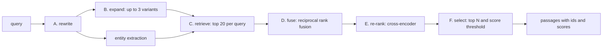

# 04. RAG Design

This document specifies the retrieval layer of the Business Management Platform: how the source documents in `rag_sources/` are chunked, embedded, stored and searched, how a query is rewritten, expanded and re-ranked, and how retrieved text is used as evidence. It satisfies requirements R-09 (every RAG module has query rewriting, query expansion and re-ranking) and R-10 (a top-level Router RAG). It describes Phase 3 behavior; the sources it refers to are the Phase 1 deliverable.

Related documents: the tool contract of `rag_tool` is in `02_architecture.md` section 6.4, the treatment of retrieved text as untrusted data is in `05_security_and_guardrails.md`, and the retrieval metrics are tied to the evaluation suite in `06_evaluation_plan.md`.

## 1. Overview

There are four indexes and one shared pipeline. Every call of `rag_tool` names an index and runs the same stages.



Design principles:

- **One pipeline, four indexes.** Index differences are configuration (section 7), not separate code.
- **Short, self-contained chunks.** The embedding model reads at most 256 word pieces, so every chunk is a complete unit of meaning that fits that limit (section 4).
- **Exact identifiers are handled outside the embedding.** Codes such as `SUP-07` or `GROC-0003` are weak signals for a dense model, so they are matched by metadata (section 8).
- **Evidence versus guidance.** Only `knowledge_base` passages are evidence for facts. Passages from the other indexes are guidance (rules, schemas, examples); every business number comes from a tool result (section 9).
- **Retrieved text is data.** No passage can change instructions, tools or permissions (see the security document).
- **Everything tunable by configuration** (section 12) and measured by the retrieval metrics (section 11).

## 2. Indexes

| Index | Used by | Source folder | Document IDs | Documents | Chunks |
|---|---|---|---|---|---|
| `router` | Router (top-level graph) | `rag_sources/router/` | RT-01 to RT-07 | 7 | 76 |
| `data_analysis` | Data Analysis subgraph | `rag_sources/data_analysis/` | DA-01 to DA-11 | 11 | 216 |
| `inventory` | Inventory subgraph | `rag_sources/inventory/` | INV-01 to INV-10 | 10 | 198 |
| `knowledge_base` | Knowledge Base subgraph | `rag_sources/knowledge_base/` | KB-POL-01 to 22, KB-BR-01 to 09, KB-SC-01 to 16, KB-CC-01 to 12, KB-EMP-01 to 10, KB-PRD-01 to 08 | 77 | 773 |
| Total | | | | 105 | 1,263 |

Counts were measured with the reference chunker described in section 4 and the heuristic token estimate. The indexer must reproduce them exactly with the same estimate and within 3 percent with the real tokenizer (section 10).

The `router` index holds the metadata descriptions of the three subgraphs (RT-02 to RT-04), the routing rules and examples, and the entity and term map. It is consulted by the router on every request. The `data_analysis` and `inventory` indexes hold, per subgraph, the SQL extraction rules, the schema reference, tested SQL and Python patterns, domain knowledge and edge-case rules. The `knowledge_base` index holds the official company documents (policies, branches, contracts, employee records, product catalogs).

## 3. Source Documents

### 3.1 File Rules

- Markdown, English only (requirement R-03). The indexer fails the build if a source file contains Arabic characters.
- The first line is the title as a level-1 heading. A bullet list directly under it is the header block.
- Content is organized in `##` sections. `###` sections are used for numbered patterns (`DA-SQL-07`), individual SKUs and sub-topics that should be retrieved separately; employee record sets use one `##` section per employee.
- Tables are Markdown pipe tables. Code is fenced and tagged `sql`, `python`, `json` or `text`.
- File names start with a two-digit number that matches the document number in its ID.

### 3.2 Header Block

| Field | Index | Meaning |
|---|---|---|
| `Document ID` | all | Unique ID. Prefix by folder: `RT-nn`, `DA-nn`, `INV-nn`, and for the knowledge base `KB-POL-nn`, `KB-BR-nn`, `KB-SC-nn`, `KB-CC-nn`, `KB-EMP-nn`, `KB-PRD-nn`. |
| `Index` | router, data_analysis, inventory | The index the document belongs to. |
| `Purpose` | router, data_analysis, inventory | One sentence on what the document is for. The subgraph descriptions RT-02 to RT-04 carry `Subgraph name` instead. |
| `Source`, `Dialect` | schema references (DA-02, INV-02) | The specification the reference was generated from, and the SQL dialect (PostgreSQL 16). |
| `Category`, `Owner`, `Effective date`, `Version`, `Last reviewed`, `Applies to`, `Classification` | knowledge_base | Document control fields. `Classification` is Public, Internal, Confidential or Restricted. |
| `Supplier code`, `Customer code`, `Location code`, `Product line code`, `Contract number` | knowledge_base (where they apply) | Subject identifiers of the document. They become `subject_ids` (section 8). |
| `Records as of` | knowledge_base (employee records) | Date of the record set. |

The sample knowledge base structure supplied with the original request was not available when these sources were written, so the header block follows the common pattern of enterprise document control (ID, owner, effective date, version, review date, classification). If a different structure is supplied, only the indexer's header parser and the generator change; the chunking rules do not.

### 3.3 Identifiers and Cross-References

Documents refer to each other by ID (`KB-POL-16`, `DA-SQL-12`, `INV-PY-03`). A reference must resolve to an existing document or example; the indexer reports unresolved references and the build fails on any (section 10).

## 4. Chunking

### 4.1 Rules

The chunker works on one document at a time and is deterministic.

1. **Header chunk.** The title and the header block form the first chunk of every document.
2. **Section chunk.** Each `##` section is one chunk when its estimated size is at most 200 tokens.
3. **Split at `###`.** A larger section is split at its `###` headings. Text before the first `###` becomes its own chunk. Each `###` unit is one chunk when it is at most 200 tokens.
4. **Split by blocks.** A section or unit that is still larger is split into blocks (paragraph, bullet list, table, code fence) and the blocks are packed into chunks of at most 200 tokens. A block larger than the budget is split further: a table by row groups with the header row repeated in every chunk, a list by items, a paragraph by sentences. A code fence is never split.
5. **Code-bearing units stay whole.** A `###` unit, or a `##` section without `###` headings, that contains a code fence is kept as one chunk even above 200 tokens (section 4.3).
6. **Prefix.** The embedded text of every chunk starts with a prefix `Title (Document ID) | Section path`, for example `Returns and Refunds (KB-POL-09) | 2. Return Window`. The prefix makes short chunks searchable by the topic of their document.

Pseudocode:

```text
for each document:
    chunks = [header_chunk]
    for each "##" section S:
        if tokens(S.body) <= 200 or (has_code(S.body) and S has no "###"):
            chunks += [S]
        else:
            chunks += pack(blocks(S.intro))                    # text before the first "###"
            for each "###" unit U in S:
                if tokens(U.body) <= 200 or has_code(U.body):
                    chunks += [U]
                else:
                    chunks += pack(blocks(U.body))
    return chunks
```

### 4.2 Token Budget

- The embedding model reads 256 word pieces; the prefix counts. The target for the body of a chunk is 200 tokens.
- Tokens are estimated as 1.3 times the number of word and punctuation tokens found by the regular expression `\w+|[^\w\s]`. The estimate is conservative for English business text and avoids loading the real tokenizer in the documentation checks.
- At build time the indexer measures the real word-piece count with the embedding model's tokenizer and fails when any embedded text exceeds 256 word pieces.
- Result with the reference chunker: no embedded text exceeds 256 estimated tokens (maximum 254).

### 4.3 Code-Bearing Units

83 units in the router, data_analysis and inventory indexes contain a code fence: 51 hold a tested SQL example, 23 hold a Python example, and 9 hold a JSON or text block. They are the units that can exceed the body budget of 200 tokens, because splitting an example would separate a query from the sentence that says when to use it. The knowledge base has none.

A SQL or Python example is retrieved by what it is for, not by its syntax. For that reason the embedded text of a code-bearing unit is its prefix plus its description (the text outside the code fence, which starts with "Use for ..."), truncated to the 256-token limit. The text returned to the model is the full unit, including the code. The cross-encoder sees the same text that was embedded.

### 4.4 Chunk Record

| Field | Meaning |
|---|---|
| `chunk_id` | `<doc_id>#<nn>`, for example `KB-POL-09#03`; `nn` is the position in the document, starting at 00 for the header chunk. |
| `doc_id`, `index_name`, `title`, `source_path` | Document identity. |
| `section_path` | `## heading` or `## heading > ### heading` (without the markers), or `Header` for the header chunk. |
| `kind` | `text` or `code`. |
| `entities` | Identifiers that are valid for the chunk: the subject IDs of its document plus every entity code found in its text (section 8). |
| `body` | Full text returned to the model. |
| `embed_text` | Text that was embedded and re-ranked. |
| `classification`, `category`, `owner`, `effective_date`, `version`, `applies_to` | Copied from the document header (knowledge base). |
| `token_estimate`, `content_hash` | Size estimate and SHA-256 of `body`. |

### 4.5 Measured Result

| Group | Documents | Chunks | Chunks per document | Mean tokens | Median | 95th percentile | Maximum |
|---|---|---|---|---|---|---|---|
| router | 7 | 76 | 10.9 | 127 | 114 | 216 | 218 |
| data_analysis | 11 | 216 | 19.6 | 141 | 144 | 216 | 220 |
| inventory | 10 | 198 | 19.8 | 142 | 136 | 215 | 254 |
| knowledge_base / policies | 22 | 216 | 9.8 | 125 | 109 | 218 | 225 |
| knowledge_base / branches | 9 | 63 | 7.0 | 109 | 106 | 176 | 180 |
| knowledge_base / supplier contracts | 16 | 176 | 11.0 | 132 | 112 | 227 | 240 |
| knowledge_base / customer agreements | 12 | 108 | 9.0 | 129 | 119 | 203 | 207 |
| knowledge_base / employee records | 10 | 61 | 6.1 | 150 | 151 | 166 | 167 |
| knowledge_base / product catalogs | 8 | 149 | 18.6 | 166 | 172 | 205 | 220 |
| All | 105 | 1,263 | 12.0 | 137 | 137 | 215 | 254 |

Token figures are estimates of the embedded text (prefix included). Per group, the median is far below the 256 limit, so most chunks carry a single topic.

## 5. Embeddings and Storage

- **Model:** `sentence-transformers/all-MiniLM-L6-v2` (`EMBEDDING_MODEL`), 384 dimensions, vectors normalized to unit length so that the cosine distance is a dot product.
- **Documents:** the `embed_text` of the chunk. **Queries:** the query text without any prefix (the model uses none).
- **Language:** English only. Arabic questions are translated before retrieval (`02_architecture.md` section 2).
- **Store:** ChromaDB, a separate service from PostgreSQL (updated from assumption A-05's approved pgvector choice to its own stated alternative -- see `docs/12_chromadb_migration.md` for why and what changed). PostgreSQL now holds only business data; the read-only role `bmp_readonly` was never granted any RAG access and there is no RAG schema left in Postgres for it to be denied against at all.

One Chroma collection per index (`rag_router`, `rag_data_analysis`, `rag_inventory`, `rag_knowledge_base`), each created with `hnsw:space: cosine` so Chroma's own HNSW index (used automatically once a collection is large enough to benefit from it; an exact scan is used below that, same as pgvector's planner would choose at this corpus's size) ranks by cosine distance. A chunk is one Chroma item:

| Chroma field | Contents |
|---|---|
| `id` | `chunk_id` |
| `embedding` | the 384-dim unit-normalized vector |
| `document` | `embed_text` (the text actually embedded) |
| `metadata.doc_id` | the owning document's ID |
| `metadata.chunk_no` | position within the document |
| `metadata.entities_csv` | the chunk's entity codes, comma-joined (Chroma metadata values are scalar -- str/int/float/bool, not arrays) |
| `metadata.record_json` | the full chunk record (title, source_path, section_path, kind, body, token_estimate, content_hash, classification, category, owner, effective_date, version, applies_to) as a JSON string, so a lookup by ID reconstructs the exact same record the indexer built |

A small `rag_meta` collection holds one item (`_meta`) whose document body is a JSON blob of the index version, the cross-document entity lexicon (section 8.2), and a `chunk_id -> index_name` map (so a lookup by chunk ID alone, needed by the re-ranking stage below, does not have to probe all four collections).

Dense search is `collection.query(query_embeddings=[...], n_results=20)` against the named index's collection; Chroma returns cosine distance, and similarity is `1 - distance`. The entity leg (only when the query contains entities) has no server-side "array contains" filter in Chroma the way `entities && $3` does in Postgres, so it is done in two steps: fetch every chunk's `entities_csv` for the index (cheap at this corpus's size, same justification as the exact-scan note above), keep the chunk IDs whose entity set intersects the query's, then fetch just those candidates' embeddings and rank them by cosine similarity directly. This is the one genuine behavioral difference from the pgvector design (there, the entity filter and the ANN search were a single indexed query); at the corpus's actual scale (about 1,300 chunks total across all four indexes) the cost difference is not measurable.

With about 1,300 chunks an exact scan has perfect recall and takes a few milliseconds either way, in Chroma as it would have in pgvector; Chroma's own ANN index engages automatically once a collection is large enough to benefit from it, so the design holds unchanged if the corpus grows by an order of magnitude.

## 6. Query Pipeline

The same stages run for all indexes. The knowledge base subgraph shows them as separate nodes (`02_architecture.md` section 4.3); the other subgraphs call `rag_tool`, which runs them internally. The stages are separate in the trace even when two of them share one LLM call.

### 6.1 Stage A: Query Rewriting

Purpose: turn the sub-question into a precise, self-contained search query.

- Input: the English `query` and the index name.
- Output (JSON): `{"rewritten": "<query>"}`.
- Rules: at most 40 words; resolve pronouns and abbreviations used in the company (GM to gross margin, DC to Distribution Center, WoC to weeks of cover); use the terms of the documents (for example "net revenue" for "sales"); keep every code, number and date from the original exactly as written; add no facts and do not answer the question.
- Check: the rewritten query must contain every entity code of the original. If it does not, the original query is used.
- Failure: if the LLM call fails or returns invalid JSON, the original query is used and a warning is added to the trace.

### 6.2 Stage B: Query Expansion

Purpose: widen recall for questions whose wording differs from the wording of the documents.

- Input: the rewritten query.
- Output (JSON): `{"variants": ["...", "...", "..."]}` with at most 3 variants (2 for the router index).
- Variant types: (1) a synonym variant that uses the vocabulary of the company (for example "return window" and "refund period after purchase"); (2) a statement variant, one declarative sentence written in the style of the document that would answer the question; (3) an aspect variant that names a sub-topic (for example "penalty for late delivery" for a question about contract terms).
- Rules: at most 25 words each; a variant must not contain a number or an entity code that is not in the query, so that expansion cannot bias retrieval toward an invented value; duplicates (same normalized text) are dropped.
- Failure: no variants; the pipeline continues with the rewritten query alone.

The rewritten query and its variants form the query set Q (1 to 4 queries).

### 6.3 Stage C: Retrieval

- Each query in Q is embedded and the **top 20** chunks by cosine similarity are retrieved from the index (dense leg).
- Entity extraction (section 8) runs on the original query. When it finds entities and `RAG_ENTITY_LEG` is true, an additional top-20 list is retrieved from the chunks whose `entities` overlap the query entities (entity leg), once per query in Q.

### 6.4 Stage D: Fusion

The ranked lists are merged with reciprocal rank fusion: `score(c) = sum over lists of 1 / (60 + rank(c))`. Chunks are sorted by this score and the best 40 (`RAG_RERANK_CANDIDATES`) are passed to re-ranking. Fusion needs no score calibration between lists and rewards chunks that several variants agree on.

### 6.5 Stage E: Re-Ranking

- Default (`RERANK_MODE=cross_encoder`): the cross-encoder `cross-encoder/ms-marco-MiniLM-L-6-v2` scores each pair (rewritten query, `embed_text` of the candidate) in one batch. Candidates are sorted by score; ties are broken by the fusion score. This is the approved re-ranker of assumption A-04.
- Fallback (`RERANK_MODE=llm`): the core LLM receives the query and the 20 best candidates (id and first 60 words each) and returns the ids in order of relevance as JSON. Used when the cross-encoder cannot be loaded.
- Failure of the re-ranker: the fusion order is used and a warning is added.

### 6.6 Stage F: Selection

1. Drop candidates whose re-rank score is below `RAG_MIN_RERANK_SCORE` (the cross-encoder returns logits; relevant pairs are mostly positive and unrelated pairs strongly negative). The initial value is -4.0 and is calibrated in M2 and M7 (section 11).
2. Keep at most `RAG_MAX_PER_DOC` (3) chunks of the same document, so that one document cannot fill all slots.
3. Return the best `RAG_FINAL_TOP_N` (6) chunks.
4. If nothing remains, return an empty list with `no_relevant_passages = true`. The caller must not substitute general knowledge (section 9).

### 6.7 Output

```json
{
  "index": "knowledge_base",
  "query": "What is the return window for defective items?",
  "rewritten": "return window for defective items days after purchase",
  "variants": ["refund period for faulty products", "Customers may return a defective item within a number of days from the order date."],
  "passages": [
    {
      "rank": 1,
      "chunk_id": "KB-POL-09#02",
      "doc_id": "KB-POL-09",
      "title": "Returns and Refunds",
      "section_path": "2. Return Window",
      "kind": "text",
      "text": "...",
      "score": 7.42,
      "classification": "Internal",
      "suspicious": false
    }
  ],
  "no_relevant_passages": false,
  "index_version": "a41c9e07",
  "timings_ms": {"rewrite": 410, "expand": 380, "retrieve": 35, "rerank": 190}
}
```

`suspicious` is set by the passage screen of the security document. A call should finish in about 3 seconds on a CPU-only host, most of it in the two LLM stages.

## 7. Index Profiles

| Setting | router | data_analysis | inventory | knowledge_base |
|---|---|---|---|---|
| Expansion variants | 2 | 3 | 3 | 3 |
| Top-k per query | 20 | 20 | 20 | 20 |
| Final passages | 8 | 6 | 6 | 6 |
| Entity leg | pattern and document IDs | pattern and document IDs | pattern and document IDs | all entity types (section 8) |
| Calls per request | 1 | up to 2 | up to 2 | 1 |
| Passages are | guidance | guidance | guidance | evidence |

- **router.** Called once per request by the router with the standalone English question. The router prompt itself carries the decision schema and the rule titles; the index supplies the rule details, the subgraph descriptions, worked examples and the entity and term map. The rewrite step keeps the intent and does not split the question.
- **data_analysis and inventory.** The plan node asks for the rules and the closest patterns; a second call is allowed when the plan names tables whose schema chunks were not returned (for example "schema of v_weekly_product_demand"). The hard rules (read-only, no `SELECT *`, blocked columns, `LIMIT`, reference date) are also fixed in the subgraph prompt, so that they never depend on retrieval.
- **knowledge_base.** One call with all stages visible as nodes. Entity-aware retrieval is essential here because the corpus holds many documents with the same structure (16 supplier contracts, 12 customer agreements, 9 branch profiles, 8 product catalogs).

## 8. Entity-Aware Retrieval

Dense embeddings do not separate `SUP-07` from `SUP-08`, or two contracts with the same layout. Identifiers are therefore matched through metadata.

### 8.1 Entities Recognized

| Entity | Pattern or source | Document or chunk reached |
|---|---|---|
| Supplier code | `SUP-\d{2}` | Supplier contract with that `Supplier code`; product catalog chunks that name the supplier |
| Supplier contract | `SC-\d{4}-\d{3}` | Supplier contract with that `Contract number` |
| Business customer code | `CUST-B\d{3}` | Customer agreement with that `Customer code` |
| Customer contract | `CC-\d{4}-\d{3}` | Customer agreement with that `Contract number` |
| Location code | `RYD-OLY`, `JED-THL`, `RYD-MLQ`, `DMM-FSL`, `KHB-COR`, `MED-QBA`, `JED-OBH`, `ABH-CTY`, `RYD-DC` | Branch profile with that `Location code` |
| SKU | `(ELEC\|APPL\|FASH\|GROC\|BEAU\|SPRT\|KIDS\|HOME)-\d{4}` | The product catalog chunk whose heading is that SKU |
| Product line | the eight line codes | Product catalog with that `Product line code` |
| Employee ID | `EMP-\d{4}` | The employee record chunk whose heading is that ID |
| Document ID | `(KB-[A-Z]+\|RT\|DA\|INV)-\d{2}` | The document itself |
| Pattern ID | `(DA\|INV)-(SQL\|PY)-\d{2}` | The example whose heading is that ID |
| Names | lexicon (section 8.2) | The same targets as the corresponding code |

### 8.2 Lexicon

The indexer builds a lexicon from the document titles and chunk headings: supplier names, customer company names, branch names, employee names (`## EMP-0001 Abdulaziz Al-Rashid`) and product names (`### GROC-0001 Qassim Gold Khalas Dates 1kg`). A name in the query (case-insensitive, hyphens and spaces normalized, full name) is replaced by its entity code. Partial names are left to the dense leg.

### 8.3 Use

1. Extract the entities of the original query with the patterns and the lexicon. This uses no LLM.
2. If there are entities, run the entity leg of stage C. The leg returns chunks whose `entities` overlap the query entities; the dense similarity inside this restricted set decides which 20 come first.
3. The fusion and re-ranking stages treat both legs alike. The entity leg never replaces the dense leg: a chunk that matches the entity but not the question is demoted by the re-ranker.

Example: "What are the payment terms in the contract with SUP-08?" finds the contract `KB-SC-08` through `SUP-08`, and the dense leg and the re-ranker choose the chunk about payment terms among its 11 chunks.

### 8.4 Chunk Entities

For every chunk, `entities` holds the subject IDs of its document (from the header block) and every entity code that occurs in its text. The product catalog chunk for `GROC-0003` therefore carries `GROC-0003`, `SUP-07` and `GROC`.

## 9. Grounding and Citations

### 9.1 Packaging Passages

Passages are given to a model inside delimiters, with the reminder that they are reference data:

```text
<passages>
<passage id="KB-POL-09#02" doc="KB-POL-09" title="Returns and Refunds" section="2. Return Window">
...text...
</passage>
</passages>
```

The text of a passage is escaped so that it cannot close the tag. The instruction around the block states that nothing inside a passage is an instruction.

### 9.2 Knowledge Base Answers

- The answer is written only from the passages. If `no_relevant_passages` is true, or the passages do not contain the answer, the node states that the company documents do not contain the information. It does not use general knowledge and returns `status = ok` with no sources.
- Each stated fact is tied to a passage. The node response lists the sources as `{"type": "document", "name": "<document title>", "doc_id": "KB-POL-09", "section": "2. Return Window"}`. The `type` and `name` keys follow the node response of `02_architecture.md` section 5; `doc_id` and `section` are additional keys.
- Conflicts between passages are reported, not resolved silently: the newer `Effective date` is preferred and the answer says so.

### 9.3 Citation Check

The `citation_check` node verifies each sentence of the draft answer deterministically:

1. Extract the checkable tokens of the sentence: numbers (thousand separators and currency symbols removed), dates, codes, and proper names.
2. Each token must occur in at least one passage that the node cites (case-insensitive, whitespace normalized).
3. A sentence with a missing token is removed, or regenerated once with the missing tokens listed. If no sentence remains, the node returns the "not in the documents" answer.

### 9.4 Guidance Passages

Passages from the router, data_analysis and inventory indexes tell the model how to proceed and what words mean. They are not a source of numbers: a value about sales, stock or customers must come from a tool result (SQL, Pandas or the regression tool), even if a guidance document states a similar value as an example. Definitions and rules taken from these documents are stated as assumptions in the node response.

### 9.5 Restricted Content

Employee record sets have the classification `Restricted`. They are retrievable like other documents, because questions about a named employee's title, reporting line or hire date are valid, but answer rules apply: compensation is given for one named employee only (see `05_security_and_guardrails.md`, which defines the enforcement).

## 10. Indexer Job

The `indexer` container reads `rag_sources/`, builds the chunks and writes them to ChromaDB (section 5).

1. Scan `rag_sources/**/*.md` in sorted order.
2. Parse each file (title, header block, sections) and run the build checks below.
3. Chunk (section 4), build `entities` and the lexicon, compute `embed_text`.
4. Embed in batches of 64 with normalization.
5. Upsert by `content_hash`: unchanged chunks are kept, changed documents are replaced in one transaction, removed documents are deleted.
6. Compute `index_version` (the first 8 characters of the SHA-256 over the sorted document IDs, content hashes and model names), write an `index_runs` row and log the counts.

The version is stored in every `rag_tool` response so that an evaluation run can be tied to an exact corpus.

### 10.1 Build Checks

| # | Check | On failure |
|---|---|---|
| 1 | Every file has a title and a `Document ID`; IDs are unique; the prefix matches the folder; the file number matches the ID number. | Fail |
| 2 | The header block of a knowledge base document has all required fields (section 3.2). | Fail |
| 3 | No Arabic characters in any file (requirement R-03). | Fail |
| 4 | Code fences are balanced; tables have a header separator; no empty section. | Fail |
| 5 | No embedded text above 256 word pieces with the real tokenizer. | Fail |
| 6 | Document count equals the manifest (105); chunk count within 3 percent of 1,263 with the real tokenizer, or equal with the heuristic estimate. | Fail |
| 7 | Every cross-reference (`KB-POL-nn`, `DA-SQL-nn`, `INV-PY-nn`, `RT-nn`, `SUP-nn`, `CUST-Bnnn`, `EMP-nnnn`, SKU) resolves. | Fail |
| 8 | Every `sql` block passes the SQL validator of the security document (parse, allow-list, no `SELECT *`, no blocked column, no system clock). | Fail |
| 9 | Every `python` block passes the Pandas validator of the security document. | Fail |
| 10 | The passage screen of the security document finds no instruction-like text in any chunk, apart from the allow-listed chunks that quote attack phrases on purpose (RT-05 Rule 1 and the injection examples of RT-06). | Fail |
| 11 | Embedding dimension is 384 for every chunk and the number of stored chunks equals the number computed. | Fail |
| 12 | The facts shared with the dataset (120 SKUs, 16 suppliers, 12 business customers, 9 locations) match the registry (`07_reference_entities.md`). | Warn in Phase 3; enforced by the Phase 2 verification script |

Phase 1 ran equivalents of checks 1 to 4 and 7 on the delivered files (105 files, 0 errors), the size part of check 5 with the heuristic estimate (maximum 254 tokens), check 8 as a PostgreSQL 16 parse and plan of all 51 SQL examples, and check 9 as an execution of all 23 Python examples on synthetic data.

## 11. Retrieval Evaluation

Retrieval is measured separately from answers, so that a wrong answer can be traced to its cause.

### 11.1 Gold Sets

Gold pairs are derived automatically from the evaluation scenarios. A scenario whose `basis.reference` names a document, section or pattern (for example `KB-POL-09`, `DA-SQL-22`, `RT-05 Rule 3`) yields the pair (sub-question, gold ID). The query is the standalone English question of the scenario (`prompt`, or `prompt_en` for Arabic prompts).

| Index | Gold pairs | Scenarios | Distinct gold IDs |
|---|---|---|---|
| `router` | 63 | 51 | 3 |
| `data_analysis` | 80 | 61 | 46 |
| `inventory` | 64 | 51 | 32 |
| `knowledge_base` | 58 | 56 | 43 |
| Total | 265 | | |

In M7 the pairs are extended with at least 20 off-corpus queries (section 11.2), and for the router with the examples of RT-06 as an additional gold set.

A hit means the gold document, or for patterns and sections the gold chunk, is among the returned passages.

### 11.2 Metrics and Targets

| Metric | Definition | Target |
|---|---|---|
| Candidate recall@40 | Gold in the 40 fused candidates | at least 0.98 |
| hit@6 (hit@8 for router) | Gold in the final passages | knowledge_base at least 0.95; data_analysis and inventory at least 0.92; router at least 0.95 |
| MRR | Mean reciprocal rank of the first gold passage | at least 0.80 |
| Re-ranker gain | MRR with the cross-encoder minus MRR of fusion order | at least +0.05 |
| False empty rate | Gold queries that return `no_relevant_passages` | at most 2 percent |
| Off-corpus empty rate | At least 20 off-corpus queries (other companies, weather, general trivia) that return `no_relevant_passages` | at least 90 percent |
| Latency | One `rag_tool` call on CPU, p95 | at most 3 seconds |

The targets are acceptance criteria for M2 (RAG core) and are re-checked in M7.

### 11.3 Ablation

Every run reports the metrics for five configurations, to show what each required technique contributes (requirement R-09):

| Configuration | Stages |
|---|---|
| A0 | Dense retrieval of the original query |
| A1 | A0 with query rewriting |
| A2 | A1 with query expansion and fusion |
| A3 | A2 with the entity leg |
| A4 | A3 with the cross-encoder re-ranking (full pipeline) |

A technique stays in the pipeline because the requirement demands it; if it does not improve the metrics it is tuned (prompts, variants, threshold) rather than removed.

### 11.4 Threshold Calibration

`RAG_MIN_RERANK_SCORE` is chosen on the gold queries and the off-corpus queries together: the highest threshold that keeps the false empty rate at or below 2 percent. The chosen value and the date are recorded in the evaluation report.

## 12. Configuration

Variables of `02_architecture.md` section 11 apply (`EMBEDDING_MODEL`, `RERANKER_MODEL`); that section's own `DATABASE_URL_RAG` is stale as of `docs/12_chromadb_migration.md` -- RAG storage configuration is now `CHROMA_HOST`/`CHROMA_PORT`/`CHROMA_PERSIST_DIR` (`app/config.py`). The RAG layer adds:

| Variable | Default | Purpose |
|---|---|---|
| `RERANK_MODE` | `cross_encoder` | `cross_encoder` or `llm` (fallback). |
| `RAG_TOP_K_PER_QUERY` | 20 | Chunks retrieved per query and leg. |
| `RAG_VARIANTS` | 3 | Expansion variants (`RAG_ROUTER_VARIANTS` = 2 for the router index). |
| `RAG_RRF_K` | 60 | Constant of reciprocal rank fusion. |
| `RAG_RERANK_CANDIDATES` | 40 | Candidates passed to re-ranking. |
| `RAG_FINAL_TOP_N` | 6 | Passages returned (`RAG_ROUTER_FINAL_TOP_N` = 8 for the router index). |
| `RAG_MAX_PER_DOC` | 3 | Maximum chunks of one document in the result. |
| `RAG_MIN_RERANK_SCORE` | -4.0 | Initial score threshold (calibrated). |
| `RAG_ENTITY_LEG` | true | Enables entity-aware retrieval. |
| `RAG_MAX_CALLS_PER_SUBGRAPH` | 2 | Limit of `rag_tool` calls per subgraph and request. |

## 13. Document Catalog

Chunk counts are the result of the reference chunker.

### 13.1 Router Index (RT, 7 documents)

| ID | Title | File | Chunks | Content |
|---|---|---|---|---|
| RT-01 | Router: System Overview | `01_system_overview.md` | 7 | What the platform is, the data it covers, what it can and cannot do. |
| RT-02 | Router: Data Analysis Subgraph Description | `02_data_analysis_subgraph.md` | 8 | Scope, hints and typical questions of the Data Analysis subgraph. |
| RT-03 | Router: Inventory Subgraph Description | `03_inventory_subgraph.md` | 8 | Scope, hints and typical questions of the Inventory subgraph. |
| RT-04 | Router: Knowledge Base Subgraph Description | `04_knowledge_base_subgraph.md` | 8 | Scope of the Knowledge Base subgraph and the 77 documents it holds. |
| RT-05 | Router: Routing Rules | `05_routing_rules.md` | 17 | Decision JSON, ordered routing rules, defaults, overlap rules, hints, follow-ups. |
| RT-06 | Router: Routing Examples | `06_routing_examples.md` | 13 | Worked routing examples, including multi-subgraph questions. |
| RT-07 | Router: Entity and Term Map | `07_entity_and_term_map.md` | 15 | Entity and term map: names, spellings, business words, time words. |

### 13.2 Data Analysis Index (DA, 11 documents)

| ID | Title | File | Chunks | Content |
|---|---|---|---|---|
| DA-01 | Data Analysis: SQL Extraction Guidelines | `01_sql_extraction_guidelines.md` | 11 | SQL hard rules (validator enforced), business rules for numbers, dates, style. |
| DA-02 | Data Analysis: Schema Reference | `02_schema_reference.md` | 59 | Schema reference: tables, views, columns, one chunk per table. |
| DA-03 | Data Analysis: SQL Patterns for Sales | `03_sql_patterns_sales.md` | 17 | Tested SQL patterns for sales questions. |
| DA-04 | Data Analysis: Pandas Execution Instructions | `04_pandas_execution_instructions.md` | 8 | Pandas sandbox contract, coding rules, result shaping. |
| DA-05 | Data Analysis: Pandas Analysis Patterns | `05_pandas_analysis_patterns.md` | 11 | Tested Pandas patterns that follow a SQL extraction. |
| DA-06 | Data Analysis: Hypothesis Testing Guide | `06_hypothesis_testing_guide.md` | 20 | When and how to run hypothesis tests and report them. |
| DA-07 | Data Analysis: Retail KPI Definitions | `07_retail_kpi_definitions.md` | 17 | Definitions of the retail measures (net revenue, margin, AOV and others). |
| DA-08 | Data Analysis: Seasonality and Calendar Knowledge | `08_seasonality_and_calendar_knowledge.md` | 26 | Season definitions, expected patterns and how to compare seasons. |
| DA-09 | Data Analysis: Customer Analytics Knowledge | `09_customer_analytics_knowledge.md` | 15 | Customer data rules (what may be returned) and customer SQL patterns. |
| DA-10 | Data Analysis: Edge Cases and Data Quality | `10_edge_cases_and_data_quality.md` | 14 | Ambiguity, partial periods, empty results and data limits. |
| DA-11 | Data Analysis: Node Response and Formatting | `11_node_response_and_formatting.md` | 18 | Node response format, with examples. |

### 13.3 Inventory Index (INV, 10 documents)

| ID | Title | File | Chunks | Content |
|---|---|---|---|---|
| INV-01 | Inventory: SQL Extraction Rules | `01_inventory_sql_extraction_rules.md` | 15 | Inventory SQL hard rules and the meaning of stock measures. |
| INV-02 | Inventory: Schema Reference | `02_schema_reference.md` | 54 | Schema reference for the inventory tables and views. |
| INV-03 | Inventory: SQL Patterns | `03_inventory_sql_patterns.md` | 14 | Tested SQL patterns for stock and purchasing questions. |
| INV-04 | Inventory: Regression Input Guidelines | `04_regression_input_guidelines.md` | 25 | When a forecast is possible, history preparation, regression tool input. |
| INV-05 | Inventory: Forecasting Models and Evaluation | `05_forecasting_models_and_evaluation.md` | 17 | Forecast models, evaluation, intervals, confidence labels. |
| INV-06 | Inventory: Domain Knowledge | `06_inventory_domain_knowledge.md` | 17 | Inventory concepts, policies, measures, lifecycle and purchase orders. |
| INV-07 | Inventory: Seasonality and Event Effects | `07_seasonality_and_event_effects.md` | 15 | Seasons and events, upcoming event windows, planning beyond the horizon. |
| INV-08 | Inventory: Supplier and Replenishment Knowledge | `08_supplier_and_replenishment_knowledge.md` | 16 | Supplier facts, delivery performance, lead times and replenishment. |
| INV-09 | Inventory: Reorder Advice Rules | `09_reorder_advice_rules.md` | 11 | Turning a forecast and stock into a reorder recommendation. |
| INV-10 | Inventory: Edge Cases and Data Quality | `10_inventory_edge_cases.md` | 14 | Ambiguous or out-of-scope inventory questions and refused actions. |

### 13.4 Knowledge Base Index (77 documents)

Company policies (KB-POL, 22 documents):

| ID | Title | Chunks |
|---|---|---|
| KB-POL-01 | Company Overview | 7 |
| KB-POL-02 | Mission and Values | 5 |
| KB-POL-03 | Organization and Leadership | 9 |
| KB-POL-04 | Branch Network | 12 |
| KB-POL-05 | Sales Channels | 6 |
| KB-POL-06 | Pricing and Discounts | 7 |
| KB-POL-07 | Promotions Calendar | 33 |
| KB-POL-08 | Nakhla Rewards Loyalty Programme | 7 |
| KB-POL-09 | Returns and Refunds | 8 |
| KB-POL-10 | Shipping and Delivery | 7 |
| KB-POL-11 | Payments and VAT | 7 |
| KB-POL-12 | B2B Sales and Credit | 12 |
| KB-POL-13 | Inventory Policy | 11 |
| KB-POL-14 | Procurement and Supplier Management | 17 |
| KB-POL-15 | Warehouse Operations | 9 |
| KB-POL-16 | Data Privacy | 9 |
| KB-POL-17 | Data Governance | 8 |
| KB-POL-18 | Human Resources Policy | 9 |
| KB-POL-19 | Code of Conduct | 9 |
| KB-POL-20 | Health and Safety | 9 |
| KB-POL-21 | Customer Service | 8 |
| KB-POL-22 | Sales Targets and Performance | 7 |

Branch profiles (KB-BR, 9 documents, one per location, same section layout):

| ID | Title | Chunks |
|---|---|---|
| KB-BR-01 | Riyadh Olaya Flagship Branch Profile | 7 |
| KB-BR-02 | Jeddah Tahlia Flagship Branch Profile | 7 |
| KB-BR-03 | Riyadh Malqa Standard Branch Profile | 7 |
| KB-BR-04 | Dammam Faisaliyah Standard Branch Profile | 7 |
| KB-BR-05 | Al Khobar Corniche Standard Branch Profile | 7 |
| KB-BR-06 | Madinah Quba Standard Branch Profile | 7 |
| KB-BR-07 | Jeddah Obhur Express Branch Profile | 7 |
| KB-BR-08 | Abha City Express Branch Profile | 7 |
| KB-BR-09 | Riyadh Distribution Center Branch Profile | 7 |

Supplier contracts (KB-SC, 16 documents, one per supplier SUP-01 to SUP-16):

| ID | Title | Chunks |
|---|---|---|
| KB-SC-01 | Supplier Contract SC-2023-001: Gulf Digital Trading Co. | 11 |
| KB-SC-02 | Supplier Contract SC-2022-002: Shenzhen Nova Electronics Ltd. | 11 |
| KB-SC-03 | Supplier Contract SC-2023-003: Al Jazeera Home Appliances Co. | 11 |
| KB-SC-04 | Supplier Contract SC-2023-004: Istanbul Cooling Systems A.S. | 11 |
| KB-SC-05 | Supplier Contract SC-2023-005: Levant Fashion House | 11 |
| KB-SC-06 | Supplier Contract SC-2024-006: Bosphorus Textile Group | 11 |
| KB-SC-07 | Supplier Contract SC-2022-007: Al Qassim Dates Cooperative | 11 |
| KB-SC-08 | Supplier Contract SC-2024-008: Mediterranean Gourmet Imports | 11 |
| KB-SC-09 | Supplier Contract SC-2023-009: Dubai Oud and Perfumes FZE | 11 |
| KB-SC-10 | Supplier Contract SC-2023-010: Paris Beaute Distribution SARL | 11 |
| KB-SC-11 | Supplier Contract SC-2024-011: Tabuk Outdoor Gear Co. | 11 |
| KB-SC-12 | Supplier Contract SC-2022-012: Munich Sport Systems GmbH | 11 |
| KB-SC-13 | Supplier Contract SC-2024-013: Cairo Educational Supplies | 11 |
| KB-SC-14 | Supplier Contract SC-2023-014: Bright Minds Toys Ltd. | 11 |
| KB-SC-15 | Supplier Contract SC-2023-015: Jeddah Home Interiors Co. | 11 |
| KB-SC-16 | Supplier Contract SC-2025-016: Milan Casa Design S.r.l. | 11 |

Customer agreements (KB-CC, 12 documents, one per contract business customer CUST-B001 to CUST-B012):

| ID | Title | Chunks |
|---|---|---|
| KB-CC-01 | Customer Agreement CC-2023-001: Al Rawabi Hospitality Group | 9 |
| KB-CC-02 | Customer Agreement CC-2023-002: Eastern Province Medical Center | 9 |
| KB-CC-03 | Customer Agreement CC-2024-003: Najd Business Schools | 9 |
| KB-CC-04 | Customer Agreement CC-2023-004: Red Sea Resorts and Spa | 9 |
| KB-CC-05 | Customer Agreement CC-2024-005: Khobar Business Park Management | 9 |
| KB-CC-06 | Customer Agreement CC-2023-006: Tuwaiq Engineering Contractors | 9 |
| KB-CC-07 | Customer Agreement CC-2024-007: Madinah Pilgrim Services Co. | 9 |
| KB-CC-08 | Customer Agreement CC-2024-008: Asir Tourism Development Co. | 9 |
| KB-CC-09 | Customer Agreement CC-2023-009: Gulf Catering Services | 9 |
| KB-CC-10 | Customer Agreement CC-2025-010: Hijaz University Staff Fund | 9 |
| KB-CC-11 | Customer Agreement CC-2024-011: Riyadh Corporate Gifting Co. | 9 |
| KB-CC-12 | Customer Agreement CC-2025-012: Al Manara Telecom Staff Association | 9 |

Employee record sets (KB-EMP, 10 documents, 41 employees, classification Restricted):

| ID | Title | Chunks |
|---|---|---|
| KB-EMP-01 | Employee Records: Executive Leadership | 7 |
| KB-EMP-02 | Employee Records: Commercial and Marketing | 7 |
| KB-EMP-03 | Employee Records: Supply Chain and Procurement | 7 |
| KB-EMP-04 | Employee Records: Finance and Human Resources | 7 |
| KB-EMP-05 | Employee Records: Technology and Data | 6 |
| KB-EMP-06 | Employee Records: Branch Managers and Distribution Center, Central Region | 5 |
| KB-EMP-07 | Employee Records: Branch Managers, Western Region | 5 |
| KB-EMP-08 | Employee Records: Branch Managers, Eastern and Southern Regions | 5 |
| KB-EMP-09 | Employee Records: Customer Service and B2B Account Management | 6 |
| KB-EMP-10 | Employee Records: Warehouse and Logistics | 6 |

Product catalogs (KB-PRD, 8 documents, one per product line, 15 SKUs each):

| ID | Title | Chunks |
|---|---|---|
| KB-PRD-01 | Product Catalog: Consumer Electronics | 18 |
| KB-PRD-02 | Product Catalog: Home Appliances | 19 |
| KB-PRD-03 | Product Catalog: Fashion and Apparel | 18 |
| KB-PRD-04 | Product Catalog: Grocery and Gourmet | 18 |
| KB-PRD-05 | Product Catalog: Beauty and Fragrance | 19 |
| KB-PRD-06 | Product Catalog: Sports and Outdoor | 19 |
| KB-PRD-07 | Product Catalog: Kids and School | 19 |
| KB-PRD-08 | Product Catalog: Home Decor and Furnishing | 19 |

## 14. Limitations

- The token estimate is heuristic. The build check with the real tokenizer is the authority, and the chunker may need a lower body budget if a document type tokenizes worse than expected (codes and numbers split into many word pieces).
- A small embedding model (384 dimensions) cannot separate near-identical documents; the entity leg compensates for codes and names but not for paraphrased references ("the dates supplier" instead of `SUP-07`). Such questions rely on the dense leg and the re-ranker, and are covered by the knowledge base scenarios.
- The English-only index means retrieval quality for an Arabic question depends on the translation step. Entity names are kept in English by the translation rules, which protects the entity leg.
- The cross-encoder was trained on web search passages, not on tables; table chunks always carry their header row and title prefix to help.
- The score threshold has two error modes (empty results for valid questions, and weak passages for off-corpus questions). The calibration in section 11.4 balances them; the knowledge base answer node is the second line of defense because it states when the passages do not contain the answer.
